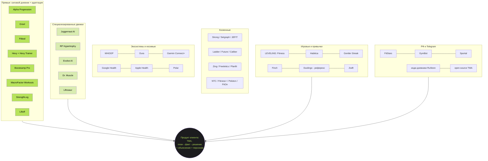
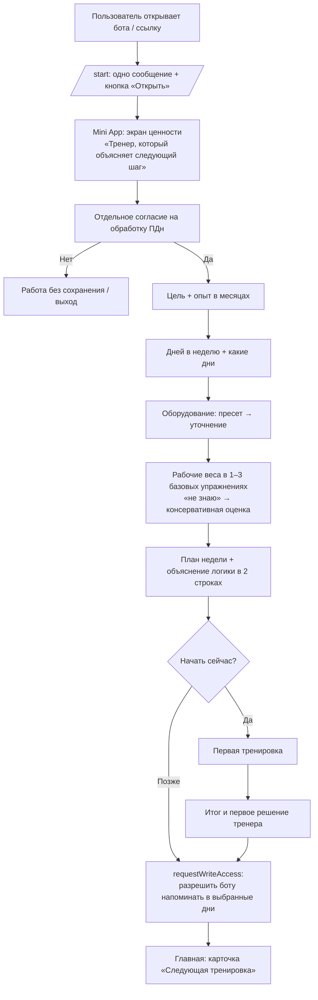
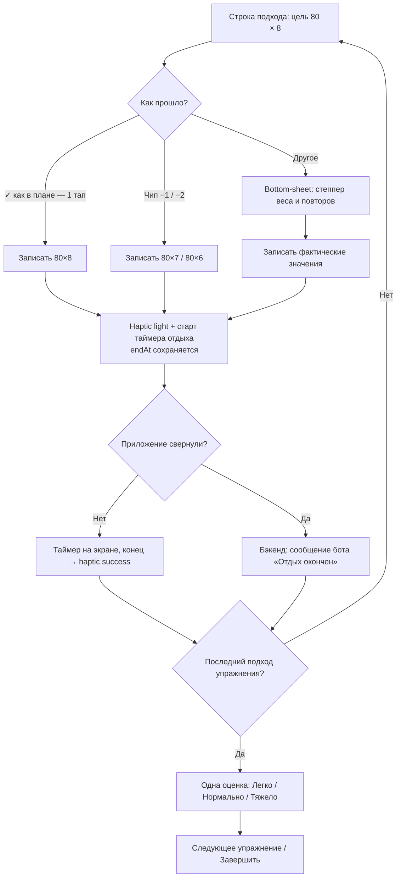
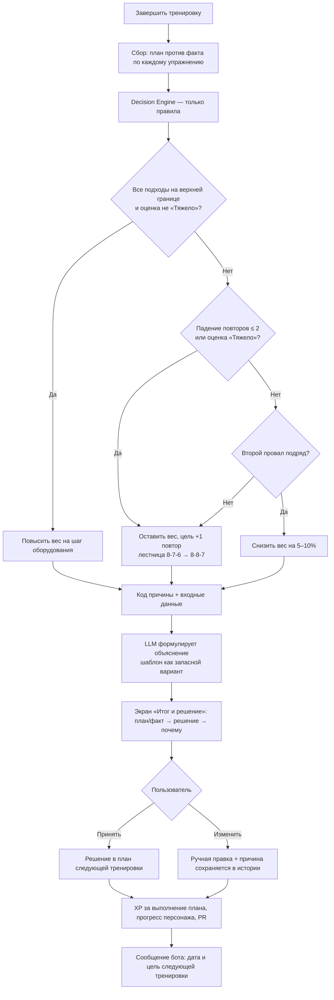
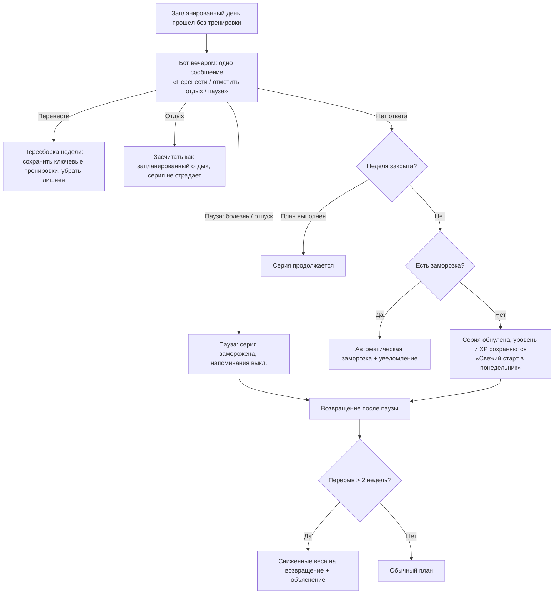

# Объяснимый силовой тренер занимает пустую нишу рынка

**Исследование рынка фитнес-приложений, состояние на 25 октября 2026 года. Исследовательская база для продукта клиента: Telegram Mini App «силовой дневник + персонаж + адаптивный тренер на правилах».**

Главный вывод исследования такой. Рынок силовых трекеров в 2026 году разделён на три слоя: дешёвые быстрые дневники за $3–5 в месяц (Hevy, Strong), адаптивные «тренеры» за $13–35 в месяц (Fitbod, Alpha Progression, Gravl, Juggernaut AI) и живых коучей за $30–200 в месяц (Ladder, Future). Почти все «AI»-тренеры на деле работают как детерминированные движки правил, и **ни один из изученных продуктов не показывает пользователю, почему было принято конкретное решение о следующей тренировке** ([SensAI, конкурент](https://www.sensai.fit/blog/juggernaut-ai-vs-rp-hypertrophy-vs-alpha-progression-2026); [Fitbod Help](https://help.fitbod.me/hc/en-us/articles/360004429814-How-Fitbod-Creates-Your-Workout)). Поэтому архитектура клиента «правила решают, LLM объясняет» не слабость, а ясное отличие, и она совпадает с тем, как устроены WHOOP Coach, Oura Advisor и MacroFactor. Русскоязычного аналога, где силовой дневник сочетается с объяснимым адаптивным тренером и строгой игровой формой, не найдено. Ближайшие примеры либо крошечные (Sportal, меньше 1 000 загрузок), либо про домашние видеотренировки (FitStars) ([mwm.ai/App Store](https://mwm.ai/apps/sportal/6756788686); [App Store FitStars](https://apps.apple.com/us/app/-/id1523287299)). Против этой возможности стоят три серьёзных ограничения. Во-первых, Telegram в России с февраля 2026 года ограничен, а месячный охват MAX по Mediascope в июне 2026 года обогнал Telegram (86,3 млн против 75,7 млн) ([3DNews](https://3dnews.ru/1145503/max-oboshyol-telegram-po-mesyachnoy-auditorii-no-eyo-prirost-pochti-ostanovilsya)). Во-вторых, цифровые товары в Mini App можно продавать только за Telegram Stars, а россиянам Stars купить трудно ([Telegram Bot API](https://core.telegram.org/bots/payments-stars); [vc.ru](https://vc.ru/life/2956296-kak-kupit-telegram-stars-v-rossii)). В-третьих, геймификация даёт реальный, но небольшой и затухающий эффект, тогда как привычка к залу формируется около 6 месяцев ([JMIR 2022](https://www.jmir.org/2022/1/e26779); [ScienceDaily/PNAS](https://sciencedaily.com/releases/2023/04/230417155750.htm)). Отсюда рекомендация: строить MVP вокруг цикла «план → факт → решение с объяснением», игровой слой держать умеренным и недельным, ядро продукта делать платформенно-независимым (веб/PWA), а Telegram рассматривать как один из каналов, в первую очередь для русскоязычного СНГ и пользователей с VPN.

---

## Executive Summary: семь выводов, которые меняют план

Этот раздел отвечает на вопрос «что строить» в сжатом виде. Подробные доказательства приведены ниже.

**1. Позиционирование подтверждено, но формулировку «AI-тренер» нужно сменить на «объяснимый тренер».** Juggernaut AI сам называет себя «expert system», MacroFactor Workouts прямо пишет «rule-based logic rather than generative AI», Hevy называет свой Trainer «an algorithm, not AI» ([SensAI](https://www.sensai.fit/blog/juggernaut-ai-vs-rp-hypertrophy-vs-alpha-progression-2026); [MacroFactor Workouts](https://macrofactor.com/workouts/); [SensAI Hevy](https://www.sensai.fit/blog/hevy-review-2026)). Рынок уже приучен к правилам. Свободно только одно: показ причины решения внутри приложения.

**2. Список конкурентов клиента нужно скорректировать.** Fitbod подтверждается как прямой конкурент. Zing и Ladder к нему не относятся: Zing не повышает рабочие веса автоматически, Ladder программирует тренировки на команду, а не на конкретного пользователя ([Trustpilot Zing](https://www.trustpilot.com/review/zing.coach?page=3); [SensAI Ladder](https://www.sensai.fit/blog/ladder-app-review-2026)). WHOOP и Oura — носимые устройства, а не конкуренты MVP. Самые близкие по логике конкуренты, которых нет в списке клиента: **Alpha Progression, Gravl, Hevy (с Hevy Trainer), Boostcamp, StrengthLog, Liftoff и MacroFactor Workouts**.

**3. Правило Gravl «8-7-6 → 8-8-8» почти совпадает с примером клиента (80×8, 80×7, 80×6).** Значит, логика движка решений уже есть на рынке, но её никто не подаёт как объяснение ([SensAI Gravl](https://www.sensai.fit/blog/gravl-app-review-2026)). Защищаемые активы клиента: качество правил, UX сравнения «план против факта», объяснение и дистрибуция.

**4. Геймификация должна поддерживать дисциплину, а не подменять её.** Эффект на физическую активность g ≈ 0.42, но после окончания вмешательства он падает до g ≈ 0.15. Против хорошего негеймифицированного трекинга прирост всего g ≈ 0.23 ([JMIR 2022](https://www.jmir.org/2022/1/e26779)). Серии нужно считать по неделям, заморозки и паузы давать без наказаний, а награды выдавать за выполнение плана, а не за объём.

**5. Россия теперь главный риск, а не главный рынок по умолчанию.** Telegram замедлен и частично недоступен без VPN. Stars трудно купить, вывод идёт через Fragment в TON с KYC. Хранение данных россиян за рубежом противоречит обновлённой ч. 5 ст. 18 152-ФЗ ([Meduza](https://meduza.io/en/news/2026/04/10/telegram-blocking-rate-in-russia-reaches-95); [Хабр](https://habr.com/ru/articles/943422)). Ядро продукта нужно строить так, чтобы его можно было вынести в веб/PWA, MAX или RuStore.

**6. MVP клиента подтверждён исследованием почти без изменений.** Питание, компьютерное зрение, носимые устройства и сообщество действительно стоит отложить. Экосистемы, которые расширялись, платили за это ростом цен и оттоком: у Peloton число подписчиков упало на 8,8% г/г ([Pelobuddy](https://www.pelobuddy.com/peloton-q4-fy2026-earnings/)). Telegram Mini App к тому же не может читать HealthKit и Health Connect ([Terra docs](https://docs.tryterra.co/faq/help-topics/data-api-sdk/mobile-sdk-setup-permissions-and-crashes/mobile-only-sources-need-sdk-not-web-or-rest)).

**7. Экономику нужно считать консервативно.** Медианы Health & Fitness на нативных платформах: D30 около 3–5%, download→paid 2,9%, первое продление 30,3% ([UXCam](https://uxcam.com/blog/mobile-app-retention-benchmarks); [RevenueCat](https://www.revenuecat.com/state-of-subscription-apps); [Adapty](https://adapty.io/state-of-in-app-subscriptions/)). Бенчмарков для фитнес-Mini App в Telegram нет. Подписка за Stars бывает только 30-дневной ([Telegram API](https://core.telegram.org/api/subscriptions)).

### Где исследование подтверждает и где поправляет допущения клиента

| Допущение клиента | Вердикт | Что показало исследование |
|---|---|---|
| Fitbod — прямой конкурент | **Подтверждено** | Генератор с адаптацией по «комфортным/тяжёлым» сессиям и восстановлению мышц, но без экрана «почему» ([Fitbod Help](https://help.fitbod.me/hc/en-us/articles/360004429814-How-Fitbod-Creates-Your-Workout)). Жалобы на «случайные» тренировки ([Trustpilot](https://www.trustpilot.com/review/fitbod.me?page=2)) |
| Zing — конкурент по адаптивной силе | **Поправка** | Zing — генералист для дома; компания подтвердила, что веса автоматически не растут ([Trustpilot](https://www.trustpilot.com/review/zing.coach?page=3)). Полезен как анти-пример онбординга (40 шагов) и биллинга ([ScreensDesign](https://screensdesign.com/showcase/zing-ai-home-gym-workouts)) |
| Ladder — AI-конкурент | **Поправка** | Тренировки пишут коучи на команду, AI используется только в питании ([SensAI Ladder](https://www.sensai.fit/blog/ladder-app-review-2026)). Конкурирует за кошелёк и привычку, а не за алгоритм. Сильный референс активации и визуала |
| WHOOP — конкурент | **Частично** | Strength Trainer строит тренировки по промпту и учитывает Recovery ([Wareable](https://www.wareable.com/fitness-trackers/whoop-coach-ai-strength-trainer-workout-builder-update)), но требует браслет за $199+/год ([WHOOP](https://www.whoop.com/au/en/membership)). Это референс для этапа «Recovery/Wearables», а не для MVP |
| Oura — конкурент | **Поправка** | Тренировок не строит, readiness-полосы дают общий совет ([Oura support](https://support.ouraring.com/hc/en-us/articles/360025589793)). С 8.06.2026 условия API запрещают передавать данные в AI-ассистентов ([Terra](https://tryterra.co/blog/oura-api-ai-apps-access-permissions-commercial-restrictions)) |
| «Правила решают, LLM объясняет» | **Подтверждено** | Так устроены WHOOP Coach, Oura Advisor и readiness-продукты ([BusinessWire WHOOP](https://www.businesswire.com/news/home/20230926899032/en/WHOOP-Unveils-the-New-WHOOP-Coach-Powered-by-OpenAI-the-First-Wearable-to-Deliver-Highly-Individualized-Performance-Coaching-on-Demand); [BusinessWire Oura](https://www.businesswire.com/news/home/20250331565896/en/Oura-Advisor-an-AI-powered-Personal-Health-Companion-Now-Rolling-Out-to-All-Oura-Members)) |
| XP за действия, а не за вес тела | **Подтверждено с уточнением** | Снижает риск нездорового отношения к телу. Но XP «за вход» по теории самодетерминации сильнее всего подрывает внутреннюю мотивацию (d = −0.40), поэтому XP лучше подавать как обратную связь о компетентности ([Deci et al. 1999](https://depts.washington.edu/techdocs/papers/deciExtrinsicRewardsAndIntrinsicMotivation99.pdf)) |
| Серии с заморозкой | **Подтверждено с уточнением** | Заморозки работают ([Duolingo](https://blog.duolingo.com/how-duolingo-streak-builds-habit)), но для силовых тренировок серия должна быть **недельной**, а не дневной (вывод исследователя) |
| Отложить питание, CV, носимые, сообщество | **Подтверждено** | См. разделы о функциях и дорожной карте |
| Telegram Mini App как единственная платформа | **Поправка (риск)** | Блокировки в РФ, ограничения Stars, нет доступа к HealthKit, нет Live Activities |

---

## Методология и надёжность: как читать цифры в этом отчёте

Отчёт собран из шести тематических блоков заметок: силовые трекеры и AI-тренеры, геймификация и монетизация, питание, экосистемы и носимые устройства, UX/UI и Telegram, локальный рынок РФ. Все утверждения сохраняют ссылку на источник. Каждое утверждение относится к одному из трёх типов. **Факт** — цифра или утверждение из первоисточника: SEC-отчётность, официальная документация, рецензируемое исследование, данные стора на дату проверки. **Заявление компании** — маркетинговая цифра вендора о себе (число пользователей, «точность»). **Оценка** — вывод исследователя или третьей стороны. Оценки в тексте помечены словами «оценка», «вывод», «экспертное суждение».

Большую часть сравнений цен и функций 2026 года опубликовали **блоги конкурентов**: SensAI, Dr. Muscle, Fitbod, Alpha Progression, Boostcamp, Coachway, FitBudd, Nutrola, PlateLens-аффилированные сайты, Sahha, Zozhnik (у него свой счётчик калорий «Зоя»). В отчёте они помечены «(конкурент)» или «(вендор)». Их цифры стоит перепроверять в сторах перед публичным использованием. Один источник прямо исключён как недостоверный: самоизданное «исследование» Dietary Assessment Initiative с «ошибкой фото 1,1%», которое противоречит всем рецензируемым работам ([DAI](https://dietaryassessmentinitiative.org/publications/six-app-validation-study-2026/)).

Ограничения сбора данных: Mobbin недоступен, видео и скриншоты напрямую не просматривались, Reddit анализировался через агрегаторы, в блоке по РФ закончился лимит поиска, а данных о трекшене фитнес-Mini App в Telegram не нашлось ни в одном источнике.

### Публичные подтверждённые метрики против заявлений и оценок

| Показатель | Значение | Тип | Источник |
|---|---|---|---|
| Duolingo DAU / MAU / платящие, Q2 2026 | 58,7 млн / 140,6 млн / 12,7 млн | Факт (SEC) | [SEC Q2 2026](https://www.sec.gov/Archives/edgar/data/0001562088/000162828026053299/q2fy26duolingo6-30x26share.htm) |
| Peloton, подписчики connected fitness, Q4 FY2026 | 2,553 млн (−8,8% г/г), приложение 503 тыс. (−9%) | Факт (отчётность, через агрегатор) | [Pelobuddy](https://www.pelobuddy.com/peloton-q4-fy2026-earnings/) |
| Peloton, доля силовых в тренировках | 30% (кардио 55%) | Факт | [Pelobuddy](https://www.pelobuddy.com/peloton-q4-fy2026-earnings/) |
| H&F download→paid (D35), медиана | 2,9% | Факт (выборка RevenueCat) | [RevenueCat SOSA 2026](https://www.revenuecat.com/state-of-subscription-apps) |
| H&F trial→paid | 37,7% (RevenueCat), 35,0% (Adapty) | Факт (выборки платформ) | [RevenueCat](https://www.revenuecat.com/state-of-subscription-apps); [Adapty](https://adapty.io/state-of-in-app-subscriptions/) |
| H&F удержание на первом продлении | 30,3% (минимум среди категорий) | Факт (Adapty) | [Adapty](https://adapty.io/state-of-in-app-subscriptions/) |
| H&F D1 / D7 / D30 | 25% / 10% / 5% (медианы) | Сводка третьей стороны | [UXCam](https://uxcam.com/blog/mobile-app-retention-benchmarks) |
| Telegram в РФ, июнь 2026 | 75,69 млн в месяц, 35,41 млн в день | Факт (Mediascope) | [3DNews](https://3dnews.ru/1145503/max-oboshyol-telegram-po-mesyachnoy-auditorii-no-eyo-prirost-pochti-ostanovilsya) |
| MAX, июнь 2026 | 86,26 млн в месяц, 69,03 млн в день | Факт (Mediascope) | [3DNews](https://3dnews.ru/1145503/max-oboshyol-telegram-po-mesyachnoy-auditorii-no-eyo-prirost-pochti-ostanovilsya) |
| RuStore, июль 2026 | 68,4 млн в месяц | Факт (Mediascope, через RuStore) | [RuStore](https://www.rustore.ru/developer/blog/reklamnyj-dajdzhest-rustore-q3-2026) |
| Рынок фитнес-услуг РФ 2025 | 215 млрд ₽ (НФС) или 270 млрд ₽ (BusinesStat) | Оценки, методологии расходятся | [BFM](https://www.bfm.ru/news/585897); [РБК Маркетинг](https://marketing.rbc.ru/articles/16464/) |
| Hevy | «17+ млн атлетов», 4,9 из 630k+ оценок | Заявление компании | [hevyapp.com](https://www.hevyapp.com/) |
| Fitbod | «более 10 млн пользователей», «100 млн тренировок» | Заявление компании | [Fitbod blog](https://fitbod.me/blog/fitbod-vs-gravl-strength-training-app-review/) |
| Ladder | 300k+ платящих; App Store 5,0 из ~212k | Заявление компании + данные стора | [SensAI Ladder (конкурент)](https://www.sensai.fit/blog/ladder-app-review-2026) |
| Gravl | 1M+ пользователей; Google Play 1M+ загрузок | Заявление + данные стора | [SensAI Gravl (конкурент)](https://www.sensai.fit/blog/gravl-app-review-2026) |
| Planfit | 4M+ пользователей, 16M+ тренировок | Заявление компании | [Planfit About](https://planfit.ai/en/about) |
| Strava | ~$490M ARR 2025, ~50M MAU, ~2% платящих | Оценка (Sacra) | [Sacra](https://sacra.com/c/strava/) |
| Cal AI | 15M+ загрузок, >$30M годовой выручки | Заявление покупателя (MFP) | [TechCrunch](https://techcrunch.com/2026/03/02/myfitnesspal-has-acquired-cal-ai-the-viral-calorie-app-built-by-teens) |
| Liftoff | ~$300 тыс. в месяц выручки, команда 2–3 человека | Оценка сторонней статьи, без первоисточника | [VentureRadar](https://ventureradar.substack.com/p/this-gym-app-built-by-college-students) |
| Finch D1/D7 | 54% / 37% | Sensor Tower через консалтинговый блог | [Deconstructor of Fun](https://www.deconstructoroffun.com/blog/x0hd2ssr80y5n7gv0w967pg7hwd7tl) |
| FitStars | ~2 млн пользователей, средний чек первой покупки 9 385 ₽ | Заявление менеджмента | [Inc. Russia](https://incrussia.ru/share/kak-my-postroili-onlajn-fitnes-s-2mln-polzovatelej/) |
| Mini Apps Telegram | ~500 млн пользователей в месяц, ~25% аудитории из РФ и СНГ | Заявление Telegram / оценка по опросу | [Код Дурова](https://kod.ru/mini-apps-telegram-trend) |

Непубличными остаются выручка Hevy, Strong, Fitbod и Gravl, удержание любого силового трекера и любые метрики фитнес-Mini App в Telegram.

## Карта рынка: три ценовых слоя силового фитнеса и пустая середина

Рынок силового софта расслоился по цене и по тому, кто принимает решение о следующей тренировке. **Дневники** за $3–5 в месяц оставляют решение пользователю и постепенно добавляют простую двойную прогрессию. **Адаптивные приложения** за $13–35 в месяц принимают решение сами, но не объясняют его. **Живые коучи** за $30–200 в месяц объясняют и решают руками человека ([SensAI pricing (конкурент)](https://www.sensai.fit/blog/fitness-app-pricing-free-tier-comparison); [SensAI Future (конкурент)](https://www.sensai.fit/blog/future-app-review-2026)). Вокруг этого ядра работают ещё четыре круга игроков: видеоплатформы для дома, экосистемы носимых устройств, игровые трекеры привычек и счётчики питания. Сильнее всего на продукт клиента давят не они, а «середина»: Alpha Progression, Gravl, Hevy Trainer. По цене и логике она ближе всего к клиенту, и её главная слабость в том, что решение «молчит».

Сила сейчас — общий вектор роста у крупных игроков. Peloton выпустил отдельное приложение Strength+ и получает 30% тренировок из силовых. WHOOP и Garmin вкладываются в моделирование силовой нагрузки. Apple в январе 2026 года добавила силовые программы в Fitness+ ([Pelobuddy](https://www.pelobuddy.com/peloton-q4-fy2026-earnings/); [9to5Google](https://9to5google.com/2026/08/20/peloton-strength-plus-android-app-release/); [the5krunner](https://the5krunner.com/2026/04/02/garmin-strength-training-features-survey/); [Athletech News](https://athletechnews.com/apple-tackles-decision-fatigue-with-new-years-fitness-rollout/)). Для клиента это двойной сигнал: ниша подтверждена, но конкуренция в ней будет расти. По оценке Sensor Tower, во 2-м квартале 2024 года в США быстрее всех среди «AI-фитнеса» росли Ladder, Lazyfit и Bodbot: выручка когорты +28% г/г, загрузки +59% ([Sensor Tower](https://sensortower.com/blog/ai-features-strengthen-fitness-apps)).

### Реестр продуктов: 50+ позиций по категориям

Категории следуют ТЗ. Один продукт может попасть в несколько категорий, но в таблице указана основная. Пометки «AI-first», «лучший UX/UI», «глубокая функциональность», «новый/быстрорастущий» вынесены в отдельный столбец.

| # | Продукт | Категория | Доп. метка | Почему включён | Что изучить глубже | Источник |
|---|---|---|---|---|---|---|
| 1 | **Alpha Progression** | Прямой | Глубина | Пошаговые рекомендации веса/повторов, RIR выводится из факта, учитывает доступные веса зала | Внутриприложные экраны: есть ли тултипы «почему» | [SensAI (конкурент)](https://www.sensai.fit/blog/juggernaut-ai-vs-rp-hypertrophy-vs-alpha-progression-2026); [App Store](https://apps.apple.com/us/app/gym-workout-alpha-progression/id1462277793) |
| 2 | **Gravl** | Прямой | Новый/быстрорастущий | Публикуемые правила: e1RM, Easy/Ideal/Hard, лестница повторов 8-7-6 → 8-8-8, потолок ~10% | Как правило показывается в UI; удержание | [SensAI Gravl (конкурент)](https://www.sensai.fit/blog/gravl-app-review-2026) |
| 3 | **Fitbod** | Прямой (назван клиентом) | Глубина | Генератор с восстановлением мышц, mStrength, прогрессия по «комфортно/тяжело» | Онбординг, двойной paywall, жалобы на «случайность» | [Fitbod Help](https://help.fitbod.me/hc/en-us/articles/360004429814-How-Fitbod-Creates-Your-Workout); [ScreensDesign](https://screensdesign.com/showcase/fitbod-gym-fitness-planner) |
| 4 | **Hevy / Hevy Trainer** | Прямой | Лучший UX/UI | Эталон строки подхода и Live Activity; Trainer с двойной прогрессией; кнопка «отправить в ChatGPT/Claude» | Как растёт из дневника в тренера; социальный граф | [hevyapp.com](https://www.hevyapp.com/); [SensAI Hevy (конкурент)](https://www.sensai.fit/blog/hevy-review-2026) |
| 5 | **MacroFactor Workouts** | Прямой | AI-позиционирование «не AI» | Прямо пишет «rule-based logic rather than generative AI» | Подача объяснений, перенос модели доверия из питания | [MacroFactor Workouts](https://macrofactor.com/workouts/) |
| 6 | **Boostcamp** | Прямой | Глубина (библиотека) | 14 000+ программ, Auto Progression в Pro, Strength Score | Как устроены «missed-rep adjustments» | [Boostcamp (сам о себе)](https://www.boostcamp.app/is-boostcamp-free) |
| 7 | **StrengthLog** | Прямой | Геймификация | Месячные челленджи, челленджи с друзьями, стрики, Strength Levels; MCP к ChatGPT/Claude | Почему часть пользователей просит отключить уровни | [App Store](https://apps.apple.com/us/app/-/id1434229662) |
| 8 | **Liftoff** | Прямой | Новый/быстрорастущий, геймификация | Ранги по силе в 600+ упражнениях, XP за подход, лидерборды, ~100 тыс. оценок | Влияние рангов по абсолютной силе на новичков | [App Store](https://apps.apple.com/us/app/liftoff-ranked-gym-workouts/id6448081563) |
| 9 | Juggernaut AI | Специализированный (пауэрлифтинг) | AI-first (expert system) | Readiness 0–100, RPE по подходам, сокращение подходов при RPE 10 | Перегруженный дашборд как анти-пример | [GGR](https://garagegymreviews.com/juggernautai-review) |
| 10 | RP Hypertrophy | Специализированный | Глубина | Объём по мышцам по обратной связи pump/soreness | Нагрузка на ручную правку | [SensAI (конкурент)](https://www.sensai.fit/blog/juggernaut-ai-vs-rp-hypertrophy-vs-alpha-progression-2026) |
| 11 | Evolve AI | Специализированный | AI-first (expert system) | Блочная периодизация, советы в конце блока | Жалоба «сон и болезненность не меняли тренировку» | [App Store](https://apps.apple.com/us/app/-/id1631174176) |
| 12 | Dr. Muscle | Специализированный | AI-first (заявлено) | «Plus set», DUP, авто-deload; PWA, написанный с помощью AI | Биллинг-жалобы, отсутствие объяснений | [GlobeNewswire](https://www.globenewswire.com/news-release/2026/01/05/3212909/0/en/AI-Workout-App-Dr-Muscle-Launches-New-App-Saves-125-000-a-Year-by-Replacing-Developers-with-AI.html); [AIToolsBakery](https://aitoolsbakery.com/blog/dr-muscle-review/) |
| 13 | Liftosaur | Специализированный | Максимальная прозрачность | Программа — текстовые правила (Liftoscript), open source | Формат «правила как текст» для продвинутых | [Liftosaur](https://www.liftosaur.com/blog/posts/liftosaur-overview/); [GitHub](https://github.com/astashov/liftosaur) |
| 14 | Strong | Косвенный (дневник) | Лучший UX/UI | «Ввод подхода в два тапа», Live Activity, лимит 3 рутины | Скорость ввода, причины апгрейда | [App Store](https://apps.apple.com/us/app/strong-workout-tracker-gym-log/id464254577) |
| 15 | Setgraph | Косвенный (дневник) | UX-находки | «Smart Plates», «next set due» вместо таймера, Dynamic Island | Ошибки мелкой кнопки «add set» | [App Store](https://apps.apple.com/us/app/setgraph-workout-tracker/id1209781676) |
| 16 | JEFIT | Косвенный (дневник) | Старожил | 1 400+ упражнений, с 2010 г., реклама в бесплатной версии | Заявления об «AI-прогрессии» (не проверено) | [SensAI (конкурент)](https://www.sensai.fit/blog/fitness-app-pricing-free-tier-comparison); [JEFIT blog](https://www.jefit.com/blog/7-best-ai-powered-progressive-overload-workout-trackers-of-2026-for-automated-strength-and-muscle-gains) |
| 17 | Planfit | Косвенный | AI-first | 4M+ пользователей (заявление), карта оборудования 245 тыс. залов | Модель «оборудование конкретного зала» | [Planfit](https://planfit.ai/en/about) |
| 18 | **Ladder** | Косвенный (назван клиентом) | Лучший UX/UI, быстрорастущий | Командные программы коучей, 5,0 из ~212k, Series B $15M + $90M go-to-market от General Catalyst | Активация через Welcome Workout, тёмная тема с неоновым акцентом | [SensAI Ladder (конкурент)](https://www.sensai.fit/blog/ladder-app-review-2026); [ScreensDesign](https://screensdesign.com/showcase/ladder-strength-training-plans) |
| 19 | Future | Косвенный (живой коуч) | Премиум | $199/мес, коуч корректирует план еженедельно | Петля «отчёт → корректировка» | [GGR](https://www.garagegymreviews.com/future-app-review) |
| 20 | Caliber | Косвенный (коуч + бесплатное приложение) | — | Бесплатное приложение, групповой коучинг $19/мес | Strength Score (не проверено) | [GGR](https://www.garagegymreviews.com/?p=206368) |
| 21 | **Zing Coach** | Косвенный (назван клиентом) | AI-first (LLM), быстрорастущий | LLM-коуч с тоном под «эмоциональный профиль», CV-тесты, $10M Series A | Анти-примеры: 40 шагов онбординга, биллинг, нет роста весов | [Pulse2](https://pulse2.com/zing-coach-ai-based-fitness-app-company-raises-10-million-in-series-a); [ScreensDesign](https://screensdesign.com/showcase/zing-ai-home-gym-workouts) |
| 22 | Freeletics | Косвенный | AI-first (заявлено) | Адаптация по обратной связи «легко/тяжело» | Механизм не раскрыт | [App Store](https://apps.apple.com/app/id654810212) |
| 23 | Gymshark Training | Косвенный | — | Бесплатные видео, слабый трекинг | Не конкурент по прогрессии | [Tom's Guide](https://tomsguide.com/wellness/fitness/gymshark-training-app-review-effective-workouts-for-free) |
| 24 | Hevy Coach | Косвенный (B2B) | — | SaaS для тренеров от $25/мес | Возможный B2B-канал в будущем | [Coachway (конкурент)](https://coachway.io/articles/hevy-coach-pricing/) |
| 25 | Trainerize | Косвенный (B2B) | Глубина | Платформа тренеров с аддонами | Цены как ориентир для B2B | [FitBudd (конкурент)](https://www.fitbudd.com/insights/trainerize-pricing-explained-what-it-actually-costs-trainers-in-2026-vs-better-alternatives) |
| 26 | **WHOOP** | Экосистема (назван клиентом) | AI-first (LLM поверх алгоритмов) | Strength Trainer, Recovery, Coach на OpenAI | Как Recovery меняет Strain-цель | [Gadgets & Wearables](https://gadgetsandwearables.com/2026/05/22/whoop-strength-trainer-2/); [WHOOP](https://www.whoop.com/au/en/membership) |
| 27 | **Oura** | Экосистема (назван клиентом) | Лучший UX (IA) | 3 вкладки по горизонту времени, progressive disclosure, Advisor | Информационная архитектура дашборда | [Oura blog](https://ouraring.com/blog/new-oura-app-experience/) |
| 28 | Garmin Connect+ | Экосистема | Глубина | Strength Coach с фазами и deload, опрос по нейромышечной готовности | Что Garmin не может: силовая нагрузка, запись подходов | [the5krunner](https://the5krunner.com/2026/04/02/garmin-strength-training-features-survey/) |
| 29 | Google Health (ex-Fitbit) | Экосистема | AI-first (Gemini) | Чат-онбординг, адаптивные планы, $9,99/мес | Чат-онбординг как формат | [TechRepublic](https://www.techrepublic.com/article/news-fitbit-ai-coach-expands-ios-five-markets/) |
| 30 | Apple Watch / Fitness+ | Экосистема | — | Training Load 7/28 дней, Workout Buddy, паузы колец | Паузы и цели по дням недели | [Apple Support](https://support.apple.com/guide/watch/track-your-training-load-apde4c07a6cf/watchos); [MacStories](https://www.macstories.net/stories/watchos-11-the-macstories-review/4/) |
| 31 | Samsung Health | Экосистема | «AI» | Energy Score, Daily Cardio Load | — | [Samsung Newsroom](https://news.samsung.com/us/samsung-health-app-evolves-with-ai-powered-proactive-intelligence-to-help-users-stay-ahead-of-their-health/) |
| 32 | Polar Fitness Program | Экосистема | Игровые уровни | 20 уровней, 4-недельные блоки, облегчение при неготовности | Уровни, привязанные к выполнению | [Polar](https://support.polar.com/en/fitness-program) |
| 33 | Peloton (App, Strength+, IQ) | Экосистема/дом | AI-first (IQ) | Предупреждение: AI и рост цен не остановили отток | Strength+ как отдельный продукт | [Pelobuddy](https://www.pelobuddy.com/peloton-q4-fy2026-earnings/); [Peloton IQ](https://www.onepeloton.com/peloton-iq) |
| 34 | Strava | Экосистема (социальная) | Быстрорастущий | Социальный граф, ~$490M ARR (оценка), покупка Runna | Kudos как недорогая социальная механика | [Sacra](https://sacra.com/c/strava/) |
| 35 | Nike Training Club | Дом/контент | — | Бесплатно, 4,8 из ~281k | Не конкурент по прогрессии | [SensAI (конкурент)](https://www.sensai.fit/blog/best-home-workout-apps-no-equipment-2026) |
| 36 | FitOn | Дом/контент | — | Бесплатные live-классы с лидербордом | — | [SensAI (конкурент)](https://www.sensai.fit/blog/nike-training-club-vs-fiton-vs-apple-fitness-plus-2026) |
| 37 | Centr / Sweat / Les Mills+ | Дом/контент | — | Программы от тренеров-селебрити $14–30/мес | Ценовые ориентиры | [SensAI](https://www.sensai.fit/blog/best-home-workout-apps-no-equipment-2026); [AppPricingLab](https://www.apppricinglab.com/iap/apple/1483001711) |
| 38 | Tonal / Tempo | Умное железо | Глубина | Адаптивный вес по сенсорам, CV-форма | Только как ориентир «Later/CV» | [Tonal](https://tonal.com/products/tonal-2); [yespress](https://yespress.io/tempo.md) |
| 39 | **LEVELING: Fitness** | Игровой | Новый | Solo Leveling-стиль: квесты, XP, ранги, гильдии, $4,99/мес | Как не уйти в аниме и «срочные» квесты | [App Store](https://apps.apple.com/us/app/-/id6624294081) |
| 40 | Habitica | Игровой | — | Потеря HP и уровня за пропуски | Главный анти-паттерн карательной механики | [Habitbox](https://habitbox.app/blog/habitica-review) |
| 41 | **Gentler Streak** | Игровой/здоровье | Лучший UX/UI (Apple Design Award 2024) | Статусы «болезнь, травма, отпуск» сохраняют стрик; сдержанный тон | Модель тона и персонажа, который «не владеет приложением» | [Sketch](https://sketch.com/blog/gentler-streak); [App Store](https://apps.apple.com/us/app/gentler-streak-workout-tracker/id1576857102) |
| 42 | Finch | Игровой (self-care) | Быстрорастущий | Цикл «задачи → энергия → эволюция питомца», D7 37% | Механика роста (без стилистики) | [Deconstructor of Fun](https://www.deconstructoroffun.com/blog/x0hd2ssr80y5n7gv0w967pg7hwd7tl) |
| 43 | Duolingo | Референс вне фитнеса | Лучшая механика серий | 600+ экспериментов со стриками, заморозки, «возрождение» | Перенос недельной логики | [Duolingo Blog](https://blog.duolingo.com/improving-the-streak) |
| 44 | Zwift | Игровой | — | Уровни 1–100, «морковки» после максимума, Progress Report вместо Streaks | Длинный хвост уровней | [Zwift Insider](https://zwiftinsider.com/level-stats-2025); [the5krunner](https://the5krunner.com/2026/01/23/peak-zwift-2026-indoor-cycling-trends/) |
| 45 | Sweatcoin / STEPN | Игровой (деньги за движение) | — | STEPN потерял ~85% MAU за 5 месяцев | Почему нельзя делать денежные награды | [Motley Fool](https://www.fool.com/investing/2022/10/20/should-investors-be-worried-about-stepn) |
| 46 | **MacroFactor** (питание) | Смежный (питание) | Лучшая модель доверия | Еженедельный check-in, «adherence-neutral», изменения с одобрения пользователя | Перенос модели доверия в тренировки | [MacroFactor](https://macrofactor.com/macrofactors-algorithms-and-core-philosophy/) |
| 47 | MyFitnessPal + Cal AI | Смежный (питание) | Быстрорастущий (Cal AI) | Фото-логирование «скорость важнее точности» | Только для этапа «Nutrition» | [TechCrunch](https://techcrunch.com/2026/03/02/myfitnesspal-has-acquired-cal-ai-the-viral-calorie-app-built-by-teens) |
| 48 | Cronometer / Lose It! / Yazio / FatSecret | Смежный (питание) | — | Цены и базы продуктов, проблемы оплаты из РФ | Для этапа «Nutrition» | [Zozhnik (конкурент)](https://zozhnik.ru/prilozhenie-dlya-podscheta-kalorij) |
| 49 | **FitStars** | РФ, дом | Крупнейший локальный | ~2 млн пользователей, стрики «Дни в ритме» с заморозкой | Канал инфлюенсеров, рублёвые цены | [Inc. Russia](https://incrussia.ru/share/kak-my-postroili-onlajn-fitnes-s-2mln-polzovatelej/) |
| 50 | **GymBot** | РФ, Telegram-бот | — | 790 ₽ за 30 тренировок разово, первая бесплатно | Разовая модель цены в Telegram | [gymbot.ru](https://gymbot.ru/) |
| 51 | Sportal | РФ, дневник | Ближайший локальный аналог | ИИ-подсказки рабочего веса, < 1 000 загрузок | Развитие, отклик аудитории | [mwm.ai](https://mwm.ai/apps/sportal/6756788686) |
| 52 | «Подход», «Дневник тренировок», Healwork, GymUp | РФ, инди-дневники | — | Бесплатные офлайн-дневники, < 1 тыс. загрузок | Почему «просто дневник» не монетизируется | [RuStore](https://www.rustore.ru/catalog/app/com.aifit.fit); [Халва Медиа](https://media.halvacard.ru/life/top-prilozenii-dlia-trenirovok-v-trenazernom-zale-dlia-devusek-i-muzcin) |
| 53 | Synchromatica Fitness и др. open-source TMA | РФ, Telegram Mini App | — | TMA с прогрессией по NSCA и CloudStorage | Технические решения TMA | [GitHub](https://github.com/Juzoo9/synchromatica-fitness) |

## Анализ конкурентов: у адаптивных тренеров есть решение, но нет его объяснения

### Профили ключевых конкурентов

Профили построены по схеме ТЗ: **факты** (с источником), **наблюдения** (что видно из описаний флоу и отзывов) и **экспертное суждение** (вывод для клиента). В профили вошли десять продуктов, которые сильнее всего влияют на решения клиента.

**Fitbod (iOS, Android, Watch).** *Факты:* учитывает цель, опыт, оборудование, сплит и длительность. Выбирает упражнения под восстановившиеся мышцы (0–100% по мышце), поднимает вес или повторы после «комфортных» сессий и снижает после тяжёлых, после перерыва даёт меньшие веса. В справке **нет термина ML и нет экрана «почему»** ([Fitbod Help](https://help.fitbod.me/hc/en-us/articles/360004429814-How-Fitbod-Creates-Your-Workout)). Цена $15,99 в месяц или $95,99 в год, бесплатного тарифа нет, 7-дневный триал с картой ([SensAI (конкурент)](https://www.sensai.fit/blog/fitness-app-pricing-free-tier-comparison)). Онбординг из 14 шагов, два paywall: до первой тренировки и на итогах после конфетти ([ScreensDesign](https://screensdesign.com/showcase/fitbod-gym-fitness-planner)). *Наблюдения:* на Trustpilot пишут «many of the workouts generated don't make sense», жалуются на триал, превратившийся в годовое списание ([Trustpilot](https://www.trustpilot.com/review/fitbod.me?page=2)). *Суждение:* главный «чёрный ящик» рынка. Клиент выигрывает у Fitbod прозрачностью и тоном, но проигрывает в объёме библиотеки (1 600+ видео, по заявлению самого Fitbod).

**Alpha Progression (iOS, Android).** *Факты:* оценивает 10RM, учитывает прошлые результаты, подходы текущего дня и доступные веса зала. RIR необязателен и выводится из факта. Рекомендации меняются от подхода к подходу. Цена $12,99 в месяц или $79,99 в год, 4,9 из 2 195 оценок ([SensAI (конкурент)](https://www.sensai.fit/blog/juggernaut-ai-vs-rp-hypertrophy-vs-alpha-progression-2026)). Есть калькулятор блинов, округляющий вниз, несколько залов с разными весами и «мини-PR» ([App Store](https://apps.apple.com/us/app/gym-workout-alpha-progression/id1462277793)). *Наблюдения:* в обзорах нет упоминаний тултипов с объяснением. *Суждение:* ближайший аналог движка решений клиента по логике. Если Alpha Progression добавит объяснения, отличие клиента сузится до Telegram, русского языка и игровой формы.

**Gravl (iOS, Android, Garmin).** *Факты:* каждый подход переводится в e1RM, упражнение оценивается как Easy, Ideal или Hard. Hard держит вес и добавляет повтор («8-7-6 → 8-8-8»), рост ограничен ~10% за сессию, при перерыве больше 2 недель нагрузка снижается на ~1% в неделю. Цена $14,99 в месяц, 4,9 из ~5,5 тыс. оценок в App Store ([SensAI Gravl (конкурент)](https://www.sensai.fit/blog/gravl-app-review-2026)). *Суждение:* правила почти совпадают с примером клиента, а одна оценка на упражнение вместо RIR на каждый подход — удачный компромисс для аудитории с опытом 6–36 месяцев.

**Hevy (iOS, Android, Web, часы).** *Факты:* «17+ млн атлетов» (заявление компании). Бесплатно: неограниченный ввод, 4 рутины. Pro стоит $2,99 в месяц или $23,99 в год ([hevyapp.com](https://www.hevyapp.com/); [SensAI Hevy (конкурент)](https://www.sensai.fit/blog/hevy-review-2026)). Hevy Trainer: двойная прогрессия, «an algorithm, not AI», без учёта готовности. Есть приложение для ChatGPT и кнопка «отправить тренировку в ChatGPT/Claude» ([SensAI Hevy](https://www.sensai.fit/blog/hevy-review-2026)). Рост в основном органический, на рекламу потрачено около $15 тыс., социальный граф основатель называет главной причиной возвращения ([RevenueCat podcast](https://www.revenuecat.com/blog/growth/guillem-ros-hevy-podcast)). *Суждение:* самый опасный конкурент в долгую. Hevy уже передаёт объяснение внешним LLM, и следующий шаг для него очевиден.

**Ladder (только iOS и Watch).** *Факты:* 23 командные программы, новый план каждое воскресенье, «coach-designed… not algorithm-generated», AI только в питании. PRO $29,99 в месяц, 5,0 из ~212 тыс. оценок, заявлено 300 тыс.+ платящих ([SensAI Ladder (конкурент)](https://www.sensai.fit/blog/ladder-app-review-2026)). В июле 2026 добавлены уведомления о плато, в августе — переносимые дни отдыха. *Суждение:* по алгоритму не конкурент, но лидер по активации (Welcome Workout) и визуальной подаче.

**Zing Coach (iOS, Android).** *Факты:* $10M Series A, LLM-коуч, CV-тесты ([Pulse2](https://pulse2.com/zing-coach-ai-based-fitness-app-company-raises-10-million-in-series-a)). Компания подтвердила на Trustpilot, что веса не растут автоматически ([Trustpilot](https://www.trustpilot.com/review/zing.coach?page=3)). Онбординг из 40 шагов с экраном-«клятвой» ([ScreensDesign](https://screensdesign.com/showcase/zing-ai-home-gym-workouts)). *Суждение:* полезен клиенту как перечень того, чего не делать.

**WHOOP.** *Факты:* членство от $199 в год, браслет входит в цену ([WHOOP](https://www.whoop.com/au/en/membership)). Strength Trainer оценивает мышечную нагрузку по весам, повторам и акселерометру ([Gadgets & Wearables](https://gadgetsandwearables.com/2026/05/22/whoop-strength-trainer-2/)). С февраля 2026 года строит тренировки по текстовому запросу и предлагает облегчённую версию при низком Recovery ([Wareable](https://www.wareable.com/fitness-trackers/whoop-coach-ai-strength-trainer-workout-builder-update)). *Наблюдения:* в сообществе пишут о «бессмысленных» скорах Recovery, а WHOOP Coach отвечает «proprietary algorithms» ([WHOOP Community](https://www.community.whoop.com/t/nonsensical-recovery-score-make-it-make-sense/9660)). *Суждение:* референс для «LLM объясняет», но и пример того, как доверие ломается без раскрытия входных данных.

**Oura.** *Факты:* членство $5,99 в месяц, readiness-полосы с типовым советом, Advisor на LLM ([Oura blog](https://ouraring.com/blog/the-value-of-oura-membership/); [Oura support](https://support.ouraring.com/hc/en-us/articles/360025589793)). *Суждение:* конкурентом не является. Ценность для клиента — в информационной архитектуре (3 вкладки, progressive disclosure).

**StrengthLog (Styrkelabbet AB, Швеция).** *Факты:* бесплатно всё для ввода, стрики, месячные челленджи и челленджи с друзьями, Strength Levels. Premium $109 в год, MCP к ChatGPT/Claude. Жалобы: мелкая кнопка «complete set», нельзя отключить уровни ([App Store](https://apps.apple.com/us/app/-/id1434229662)). *Суждение:* ближайший западный пример «силовой дневник + геймификация» и предупреждение: игровой слой нужно уметь выключать.

**Liftoff.** *Факты:* ранги по силе в 600+ упражнениях, лидерборды, ~100 тыс. оценок со средней 4,8 ([App Store](https://apps.apple.com/us/app/liftoff-ranked-gym-workouts/id6448081563)). Выручка около $300 тыс. в месяц по оценке сторонней статьи без первоисточника ([VentureRadar](https://ventureradar.substack.com/p/this-gym-app-built-by-college-students)). *Суждение:* доказывает спрос на силовую геймификацию у молодой аудитории, но ранжирует по абсолютной силе, а это для взрослого новичка демотивирует (см. раздел о геймификации).

### Матрица сравнения (1–5)

**Критерии и шкала.** **Адаптация** (A): 1 — нет авто-прогрессии, 3 — двойная или линейная прогрессия, 5 — пошаговая подстройка по факту с учётом усталости и перерывов. **Прозрачность решений** (П): 1 — чёрный ящик, 3 — логика описана в справке или обзорах, 5 — причина показана в интерфейсе. **Скорость ввода** (В): 1 — много тапов и клавиатура, 5 — предзаполнение, отметка одним тапом, автотаймер. **Геймификация** (Г): 1 — нет, 3 — стрики и достижения, 5 — система прогресса (уровни, задания, челленджи). **Доступность цены** (Ц): 5 — сильный бесплатный тариф или до $5 в месяц, 1 — от $30 в месяц. **Онбординг** (О): 5 — быстро ведёт к ценности, 1 — длинный и с давлением. **Доверие и биллинг** (Д): 5 — нет жалоб на списания, 1 — системные жалобы. **Локализация РФ** (Р): 5 — русский язык и рублёвая оплата, 1 — нет. Пометка «н/д» означает «недостаточно данных». Все оценки — **экспертное суждение** на основе фактов, приведённых выше. Это не результат собственного тестирования.

| Продукт | A | П | В | Г | Ц | О | Д | Р |
|---|---|---|---|---|---|---|---|---|
| Fitbod | 4 | 2 | 3 | 2 | 2 | 3 | 2 | н/д |
| Alpha Progression | 5 | 3 | 4 | 2 | 3 | н/д | 4 | н/д (13 языков) |
| Gravl | 4 | 3 | 4 | н/д | 3 | н/д | н/д | н/д |
| Hevy (+Trainer) | 3 | 3 | 5 | 3 | 5 | н/д | 5 | н/д |
| Strong | 1 | — | 5 | 1 | 4 | н/д | 4 | н/д |
| StrengthLog | 3 | 3 | 3 | 4 | 3 | н/д | н/д | н/д |
| Liftoff | н/д | н/д | н/д | 5 | 4 | н/д | н/д | н/д |
| Juggernaut AI | 5 | 2 | 3 | 1 | 1 | 2 | н/д | 1 |
| RP Hypertrophy | 4 | 3 | 2 | 1 | 1 | н/д | 3 | 1 (только англ.) |
| Boostcamp | 3 | 3 | н/д | 3 | 4 | н/д | н/д | н/д |
| MacroFactor Workouts | 4 | 4 | н/д | 1 | 2 | н/д | н/д | н/д |
| Ladder | 2 | 2 | 3 | 3 | 1 | 4 | н/д | 1 (нет Android) |
| Zing | 1 | 1 | 2 | н/д | н/д | 1 | 1 | н/д |
| WHOOP (Strength Trainer) | 3 | 2 | н/д | 2 | 1 | н/д | н/д | н/д |
| GymBot (TG) | 2 | н/д | 2 | 1 | 4 | 4 | н/д | 5 |
| FitStars | 1 | н/д | н/д | 3 | 2 | н/д | н/д | 5 |
| **Целевой профиль клиента** | 4 | **5** | 4 | 4 | 4 | 4 | 5 | 4–5 |

Обоснование ключевых оценок: Hevy В=5 за автозаполнение и автотаймер ([Hevy](https://www.hevyapp.com/features/track-workouts/)). Alpha Progression A=5 за подстройку по каждому подходу и П=3 потому, что логика описана только в обзорах. Zing A=1 из-за подтверждённого отсутствия роста весов, Д=1 из-за массовых биллинг-жалоб. Fitbod П=2: механика есть в справке, но в интерфейсе виден только heatmap восстановления ([Fitbod Help](https://help.fitbod.me/hc/en-us/articles/360004429814-How-Fitbod-Creates-Your-Workout)). Ladder A=2: план еженедельный и командный, переносимые дни отдыха и уведомления о плато появились только в 2026 году. Juggernaut О=2 за запутанный дашборд ([GGR](https://garagegymreviews.com/juggernautai-review)).

### Лидеры по отдельным критериям (единого «лучшего» нет)

| Критерий | Лидер(ы) | Почему | Что взять клиенту |
|---|---|---|---|
| Глубина адаптации | Alpha Progression, Juggernaut AI | Подстройка по каждому подходу, RPE и readiness | Логику пошаговой цели, но без обязательного RPE |
| Публичность правил | Gravl, Liftosaur | Правила опубликованы или редактируются как текст | Опубликовать «как думает тренер» |
| Модель доверия к алгоритму | MacroFactor | Еженедельный check-in, изменения с одобрения, перечень случаев, где модель ошибается ([MacroFactor](https://macrofactor.com/macrofactors-algorithms-and-core-philosophy/)) | Перенести целиком |
| Скорость ввода | Hevy, Strong | Предзаполнение, отметка в два тапа, автотаймер | Строка подхода как стандарт |
| Активация | Ladder | Welcome Workout открывает план | Первая тренировка как часть онбординга |
| Информационная архитектура | Oura, WHOOP | 2–3 скора сверху, детали по тапу | Главный экран |
| Тон и мягкий стрик | Gentler Streak | Статусы болезни и отпуска, «supportive but not cheesy» | Тон текстов и паузы |
| Механика серий | Duolingo | Заморозки, возрождение, отделение серии от цели | Недельная серия с заморозкой |
| Силовая геймификация | StrengthLog, Liftoff | Челленджи, ранги, XP | Механики, но с opt-out и без ранжирования по абсолютной силе |
| Цена и бесплатный тариф | Hevy | Сильный бесплатный тариф, Pro $2,99 | Бесплатное ядро дневника |
| Локальный рынок | FitStars (дом), GymBot (TG) | Рубли, русский язык, разовые пакеты | Рублёвый ценовой коридор |

## UX/UI: рынок договорился о строке подхода, а Telegram отнимает Live Activity

### Онбординг: ценность до вопросов, paywall после первой тренировки

У «коучинговых» приложений длинный онбординг: 14 шагов у Fitbod, 40 у Zing ([ScreensDesign Fitbod](https://screensdesign.com/showcase/fitbod-gym-fitness-planner); [ScreensDesign Zing](https://screensdesign.com/showcase/zing-ai-home-gym-workouts)). RevenueCat показывает, что в Health & Fitness длина окупается, но только если каждый вопрос создаёт ощущение персонализации и объясняет, зачем он задан. Lose It! получил двузначный прирост trial starts, добавляя вопросы, пока отдача не пошла вниз ([RevenueCat](https://www.revenuecat.com/blog/growth/why-your-onboarding-experience-might-be-too-short.md)). В 54% онбордингов H&F есть paywall, и он стоит ближе к концу, на относительной позиции около 0,84. Выборка при этом небольшая, 26 приложений ([Lazyweb](https://www.lazyweb.com/research/do-health-and-fitness-apps-paywall-in-onboarding.md)). Ladder закрывает недельный план, пока пользователь не пройдёт Welcome Workout, и превращает первую тренировку в часть онбординга ([ScreensDesign Ladder](https://screensdesign.com/showcase/ladder-strength-training-plans)). Генераторы планов Alpha Progression и Hevy Trainer спрашивают одно и то же: цель, опыт, оборудование, частоту, длительность и приоритетные мышцы ([Alpha Progression vs Hevy](https://alphaprogression.com/en/blog/alpha-progression-vs-hevy)).

**Рекомендация (экспертное суждение).** Онбординг клиента из 6–8 экранов: цель, опыт в месяцах, частота, оборудование (пресет + уточнение), 1–3 текущих рабочих веса в базовых упражнениях (вместо холодного старта — у Gravl первая оценка берётся из заявленного уровня), согласие на обработку данных отдельным экраном (см. риски 152-ФЗ). Под каждым вопросом одна строка «зачем спрашиваем». Затем сразу первая тренировка. Paywall не ставить между планом и первой тренировкой: в Telegram вход «холодный», а Stars пользователю ещё нужно купить.

### Главный экран: одна карточка «что делать сегодня» выше персонажа

WHOOP держит сверху три дуги (Sleep, Recovery, Strain), а план недели вынесен на Home ([WHOOP community](https://www.community.whoop.com/t/what-s-new-with-how-the-app-looks/822)). Oura в 2024 году сократила 5 вкладок до 3 (Today, Vitals, My Health) и открывает детали стрелками contributors и details ([Oura blog](https://ouraring.com/blog/new-oura-app-experience/)). Gentler Streak пришлось добавить кнопку «What's Activity Path», потому что концепция не считывалась ([App Store](https://apps.apple.com/us/app/gentler-streak-workout-tracker/id1576857102)). **Рекомендация:** над сгибом одна карточка «Тренировка сегодня» с решением тренера в одну строку и кнопкой старта в MainButton. Ниже 2–3 индикатора из собственных данных (выполнение недельного плана, недельная серия, уровень персонажа) с подписью формулы. Каждая новая концепция при первом показе объясняется.

### Активная тренировка: строка подхода «цель · факт · дельта · ✓»

Стандарт рынка описан у Hevy: номер подхода (тап меняет тип: разминка, дроп, отказ), вес, повторы, галочка. Галочка запускает таймер отдыха, свой для каждого упражнения. Значения прошлой сессии предзаполнены, источник «previous» настраивается, RPE включается отдельной колонкой, калькуляторы блинов и разминки находятся над клавиатурой ([Hevy](https://www.hevyapp.com/features/track-workouts/)). Strong называют приложением с «вводом подхода в два тапа» ([SensAI (конкурент)](https://www.sensai.fit/blog/hevy-vs-strong-vs-fitbod-vs-jefit)). Ошибки тоже известны: мелкие или неоднозначные зоны тапа в StrengthLog и Setgraph приводят к случайной правке ([App Store StrengthLog](https://apps.apple.com/us/app/-/id1434229662); [App Store Setgraph](https://apps.apple.com/us/app/setgraph-workout-tracker/id1209781676)). Alpha Progression и Gravl округляют рекомендации до весов, которые реально есть в зале ([App Store](https://apps.apple.com/us/app/gym-workout-alpha-progression/id1462277793); [SensAI Gravl](https://www.sensai.fit/blog/gravl-app-review-2026)). Apple HIG требует, чтобы активная тренировка выглядела отдельным режимом, без нерелевантных элементов, с крупными контролами и экраном итогов ([HIG Workouts](https://developer.apple.com/design/human-interface-guidelines/workouts.md)).

**Рекомендация.** Строка подхода показывает цель тренера («80 × 8»), одну крупную кнопку «✓ как в плане» и быстрые чипы «−1 / −2 / другое» для недовыполнения. Так пример клиента 80×8 → 80×7 → 80×6 вводится тремя тапами. Оценка усилия — одна на упражнение (Легко / Нормально / Тяжело, как у Gravl), а не RIR на каждый подход. Самооценка RIR ненадёжна: в среднем люди ошибаются примерно на 0,95 повтора до отказа (мета-анализ 12 исследований, по пересказу конкурента) ([SensAI](https://www.sensai.fit/blog/juggernaut-ai-vs-rp-hypertrophy-vs-alpha-progression-2026)). Вес и повторы набираются от 20–24 pt, таймер от 48 pt, цифры табличные.

### Итог тренировки и решение: здесь продукт клиента отличается от всех

Hevy на итогах показывает номер тренировки, недельный стрик, PR и сводку за 7 дней ([Hevy](https://www.hevyapp.com/features/track-workouts/)). Fitbod показывает конфетти и затем paywall с прогнозом на 90 дней ([ScreensDesign](https://screensdesign.com/showcase/fitbod-gym-fitness-planner)). Ladder предлагает звёздную оценку и стену селфи ([ScreensDesign](https://screensdesign.com/apps/ladder-strength-training-plans/)). Future собирает самочувствие для коуча ([GGR](https://www.garagegymreviews.com/future-app-review)). **Ни у кого из них нет карточки «план против факта → решение → причина».** Рекомендуемая структура экрана «Итог и решение ИИ»: (1) таблица «план / факт» по ключевым упражнениям с дельтами; (2) решение тренера одной строкой («Жим лёжа: оставить 80 кг, цель 8/8/7»); (3) причина в формате «правило → вывод» («повторы упали больше чем на 2 за упражнение → вес не повышаем»); (4) какие входные данные повлияли («ваша оценка “Тяжело” учтена»); (5) кнопки «Принять / Изменить» по модели MacroFactor; (6) только после этого XP и прогресс персонажа.

### Прогресс и карточка упражнения

Fitbod показывает аватар восстановления мышц 0–100% с поворотом и историей по тапу ([Fitbod Help](https://help.fitbod.me/hc/en-us/articles/360006269014-Muscle-Recovery)). Hevy бесплатно даёт body graph за 7 дней и число подходов по группам мышц ([Hevy](https://www.hevyapp.com/features/muscle-group-workout-chart/)). Setgraph просят сравнивать результат не только с прошлым разом, но и со средним ([App Store](https://apps.apple.com/us/app/setgraph-workout-tracker/id1209781676)). Даже у Garmin нет модели нейромышечной готовности: она пока на стадии опроса пользователей ([the5krunner](https://the5krunner.com/2026/04/02/garmin-strength-training-features-survey/)). **Рекомендация:** карточка упражнения с e1RM-трендом, PR, историей «план/факт» и последними решениями тренера по этому упражнению. Мышечную карту делать как число подходов по группам с подписями, не опираясь только на цвет.

### Ограничения Telegram Mini App, которые меняют дизайн

| Ограничение / возможность | Факт | Следствие для дизайна |
|---|---|---|
| Нет Live Activities и фоновых таймеров ОС | В изученной документации аналога нет ([Telegram docs](https://core.telegram.org/bots/webapps)) | Таймер хранить как время окончания (endAt) и пересчитывать на событии `activated`. Сигнал «отдых окончен» при свёрнутом приложении доставлять сообщением бота после `requestWriteAccess` (вывод из архитектуры, не проверено тестами) |
| Нет HealthKit и Health Connect | Обе платформы работают только на устройстве, веб-API нет ([Terra docs](https://docs.tryterra.co/faq/help-topics/data-api-sdk/mobile-sdk-setup-permissions-and-crashes/mobile-only-sources-need-sdk-not-web-or-rest)) | Вес тела, сон и самочувствие вводятся вручную. Скор готовности не называть «recovery» |
| BottomButton (Main и Secondary) | С Bot API 7.10, есть позиция и прогресс ([Telegram docs](https://core.telegram.org/bots/webapps)) | «✓ подход» и «Следующее упражнение» в нижней трети, под большой палец |
| HapticFeedback | `impactOccurred`, `notificationOccurred`, `selectionChanged` ([Telegram docs](https://core.telegram.org/bots/webapps)) | light на ✓, success на PR и конец отдыха |
| themeParams | ~15 цветов темы пользователя ([Telegram docs](https://core.telegram.org/bots/webapps)) | Лайм #B7E35B на белом даёт контраст 1,48:1 (собственный расчёт по формуле [W3C](https://www.w3.org/WAI/WCAG22/Understanding/contrast-minimum.html)). Нужна либо зафиксированная тёмная тема, либо второй набор токенов |
| Viewport и клавиатура | `100vh` ломает раскладку, клавиатура Android сжимает viewport ([HackerNoon](https://hackernoon.com/building-a-business-app-on-telegram-4-lessons-we-learned-the-hard-way)) | Свой цифровой блок или степперы в bottom-sheet вместо системной клавиатуры (гипотеза) |
| Хранилища | CloudStorage: 1024 ключа по 4096 символов; DeviceStorage 5 MB ([Telegram docs](https://core.telegram.org/bots/webapps)) | Только настройки и черновик тренировки. История на сервере в РФ (152-ФЗ) |
| Навигация | Совет: не делать многоуровневую навигацию и не дублировать «Назад» ([Sostav](https://www.sostav.ru/blogs/281129/67478)) | 9 экранов прототипа свести к 4–5 табам, остальное — модальные потоки с BackButton |
| Ярлык на домашнем экране, подарки, emoji-статусы | Mini Apps 2.0 ([CXOToday](https://cxotoday.com/press-release/telegram-unveils-mini-apps-2-0-full-screen-mode-home-screen-icons-geolocation-and-more/)) | Предлагать ярлык после 2-й тренировки; подарки и статусы как неденежные награды за ранги |
| UI-кит | `@telegram-apps/telegram-ui`, MIT, 866 звёзд, статус поддержки не заявлен ([GitHub](https://github.com/telegram-mini-apps-dev/TelegramUI)) | Брать как базу с осторожностью |

### Визуальные тренды 2025–2026

| Тренд | Суть | Примеры | Задача | Плюсы | Минусы | Рекомендация |
|---|---|---|---|---|---|---|
| Тёмная тема + один неоновый акцент | Графит, один яркий цвет для действий и успеха | Ladder: жёлтый акцент и лаймовая галочка ([ScreensDesign](https://screensdesign.com/apps/ladder-strength-training-plans/)) | Фокус, атмосфера зала | Лайм на #1C1C1E — 11,5:1 | На белом 1,48:1 | Сохранить #B7E35B, текст на лайме только чёрный, для светлой темы — оливковый вариант |
| Кольца и шкалы готовности | 1–3 скора сверху | WHOOP, Oura ([Oura blog](https://ouraring.com/blog/new-oura-app-experience/)) | Ответ «что делать сегодня» за секунду | Быстро считывается | Без носимого устройства скор «фейковый» | Скор из своих данных с подписанной формулой |
| Мышечная карта | Силуэт с подсветкой | Fitbod, Hevy | Баланс нагрузки | Наглядно | Сложная SVG, зависимость от цвета | В Прогрессе и Итоге, с числами |
| Progressive disclosure | Итог сначала, детали по тапу | Oura, WHOOP | Меньше шума | Подходит для 375 px | Глубина конфликтует с BackButton | Не больше двух уровней, bottom-sheet |
| Bento-сетка | Модульные карточки | Только в обзоре трендов, без фитнес-примеров ([Moburst](https://www.moburst.com/blog/top-mobile-web-design-trends/)) | Сканируемый дашборд | Модульность | Мелкие тайлы на 375 px | Только ниже первого экрана |
| Крупная «редакционная» типографика | Крупные цифры, минимум декора | HIG требует крупный текст в движении ([HIG](https://developer.apple.com/design/human-interface-guidelines/workouts.md)) | Читаемость на вытянутой руке | Деловой тон | Занимает место | 20–24 pt для веса и повторов, 48 pt для таймера |
| Персонаж-компаньон | Существо растёт от действий | Finch, Duolingo, Gentler Streak ([Sketch](https://sketch.com/blog/gentler-streak)) | Эмоциональная связь | Finch D7 37% (консалтинговый блог) | Инфантильность | Строгий геометрический «атлет», эволюция через экипировку и осанку, персонаж «не владеет приложением» |
| Микроанимации и хаптика | Отклик на подход, PR, отдых | Duolingo, Ladder | Ощущение «засчитано» | Дёшево через API Telegram | Перебор утомляет | Учитывать `prefers-reduced-motion` |
| Управление одной рукой | Действия внизу | BottomButton Telegram | Телефон между подходами | Нативно | — | Ключевые действия в MainButton |
| Liquid Glass | Полупрозрачные контролы | iOS/watchOS 26 ([Apple](https://www.apple.com/newsroom/2025/06/watchos-26-delivers-more-personalized-ways-to-stay-active-and-connected/)) | Системная эстетика | Современно | Дорого в WebView на слабых Android | Не использовать |
| Video-first | Короткие видео-петли | Duolingo, Calm (по Moburst), видео-демо Ladder | Показать технику | Наглядно | Трафик в Telegram | Только в карточке упражнения, ленивая загрузка |
| Calm / low-stimulus UI | Спокойный интерфейс | Обзор трендов ([Moburst](https://www.moburst.com/blog/top-mobile-web-design-trends/)) | Снижение тревоги | Совпадает со строгим тоном | Может выглядеть скучно | Базовый принцип, акцент только на действии |

### Библиотека дизайн-референсов

| Продукт | Экран | Решение | Источник | Зачем изучать |
|---|---|---|---|---|
| Hevy | Тренировка | Предзаполнение, тип подхода по тапу, ✓ запускает таймер | [hevyapp.com](https://www.hevyapp.com/features/track-workouts/) | Эталон строки подхода |
| Hevy | Live Activity | Подход отмечается с экрана блокировки, отдых ±15 с | [hevyapp.com](https://www.hevyapp.com/features/live-activity/) | Что заменять сообщениями бота |
| Hevy | Итоги, прогресс | Номер тренировки, стрик, PR; body graph | [hevyapp.com](https://www.hevyapp.com/features/muscle-group-workout-chart/) | Структура Summary |
| Strong | Тренировка | Автотаймер, калькуляторы, 4,9 из 109K | [App Store](https://apps.apple.com/us/app/strong-workout-tracker-gym-log/id464254577) | Минимализм |
| Alpha Progression | Рекомендация | Цель на каждый подход с учётом весов зала | [Alpha Progression](https://alphaprogression.com/en/blog/alpha-progression-vs-hevy) | Аналог движка решений |
| MacroFactor Workouts | Позиционирование | «Rule-based, not generative AI» | [MacroFactor](https://macrofactor.com/workouts/) | Подача объяснимого тренера |
| MacroFactor (питание) | Check-in | Изменения предлагаются и принимаются пользователем | [Help](https://help.macrofactorapp.com/en/articles/222-how-does-macrofactor-make-adjustments-for-a-weight-gain-or-weight-loss-goal) | Экран «Решение» |
| Fitbod | Онбординг, восстановление | 14 шагов, прогноз силы, аватар 0–100% | [ScreensDesign](https://screensdesign.com/showcase/fitbod-gym-fitness-planner); [Help](https://help.fitbod.me/hc/en-us/articles/360006269014-Muscle-Recovery) | Пример и анти-пример |
| Ladder | Активация, визуал | Welcome Workout, тёмная тема, Swap Movement | [ScreensDesign](https://screensdesign.com/apps/ladder-strength-training-plans/) | Активация и стиль |
| Zing | Онбординг | 40 шагов, «клятва», апселл | [ScreensDesign](https://screensdesign.com/showcase/zing-ai-home-gym-workouts) | Чего избегать |
| WHOOP | Home | Три дуги, план недели | [WHOOP community](https://www.community.whoop.com/t/what-s-new-with-how-the-app-looks/822) | Иерархия |
| Oura | Today | 3 вкладки, progressive disclosure | [Oura blog](https://ouraring.com/blog/new-oura-app-experience/) | Информационная архитектура |
| Gentler Streak | Тон, стрик | Статусы болезни и отпуска | [Sketch](https://sketch.com/blog/gentler-streak) | Тон и пауза |
| Finch | Персонаж | Задачи → энергия → эволюция | [Deconstructor of Fun](https://www.deconstructoroffun.com/blog/x0hd2ssr80y5n7gv0w967pg7hwd7tl) | Механика без стилистики |
| Duolingo | Персонажи, серии | Геометрия форм; заморозки | [Duolingo](https://blog.duolingo.com/building-character/) | Строгий, но живой персонаж |
| Apple HIG | Workouts, Accessibility | 44 pt, 4,5:1, Reduce Motion | [HIG](https://developer.apple.com/design/human-interface-guidelines/accessibility.md) | Нормативы дизайн-системы |
| Telegram | Платформа | themeParams, кнопки, хаптика | [core.telegram.org](https://core.telegram.org/bots/webapps) | Ограничения |
| CryptoBot, Beem, Zealy | TMA-флоу | Переход из чата меньше 5 с, сценарии по 3–4 шага | [Sostav](https://www.sostav.ru/blogs/280723/63174) | Нативный TMA-UX |

## Репозиторий функций: что реально делает «AI» и что строить

### Каталог функций по категориям

| Категория | Функции на рынке | Кто делает | Реальный AI или правила |
|---|---|---|---|
| Ввод тренировки | Предзаполнение, типы подходов, суперсеты, автотаймер, калькуляторы блинов и разминки, Live Activity, часы | Hevy, Strong, Setgraph, Alpha Progression | Правила/UI |
| Планирование | Генератор программы по анкете, библиотека программ, сплиты, deload-недели | Fitbod, Alpha Progression, Boostcamp, Hevy Trainer | Правила (Fitbod называет движок mStrength) |
| Адаптация | Двойная/линейная прогрессия, e1RM, RPE/RIR, readiness, лестница повторов, снижение после перерыва | Gravl, Alpha Progression, Juggernaut, RP, Dr. Muscle | Правила или expert system |
| Объяснение | Внешний LLM по кнопке, MCP, советы в конце блока, LLM-чат по данным носимых | Hevy, StrengthLog, Evolve, WHOOP Coach, Oura Advisor | LLM поверх данных (кроме Evolve) |
| Генерация по тексту | Тренировка по промпту, скриншоту или PDF | WHOOP Strength Trainer, Hevy для ChatGPT | LLM |
| Прогресс | Графики 1RM и объёма, PR, мини-PR, мышечные карты, Strength Score/Levels | Hevy, Alpha Progression, Boostcamp, StrengthLog, Fitbod | Расчёты |
| Геймификация | Стрики, заморозки, челленджи, ранги по силе, XP, уровни, гильдии | StrengthLog, Liftoff, LEVELING, Polar, Zwift | Правила |
| Социальное | Лента, kudos, копирование рутин, командные программы | Hevy, Strava, Ladder | — |
| Коучинг человеком | Чат, видео техники, корректировка недели | Future, Ladder ELITE+, Caliber | Человек |
| Готовность | Скор 0–100 из HRV, сна и нагрузки | WHOOP, Oura, Garmin | Алгоритм с полосами и типовым советом |
| CV | Подсчёт повторов, обратная связь по технике | Peloton IQ, Tonal, Zing | ML/CV (точность ограничена: 12 повторов вместо 10 у Peloton) ([The Clip Out](https://theclipout.com/peloton-iq-womens-health-fast-company-review/)) |
| Питание | Адаптивные калории, фото-логирование, белок | MacroFactor, MFP/Cal AI, Carbon | Алгоритм + LLM-vision |

### Ключевые функции в разборе

**Адаптивное решение о следующем шаге (Decision Engine).** *Проблема:* пользователь с опытом 6–36 месяцев не знает, когда повышать вес, и упирается в плато. Это гипотеза клиента H1, и на рынке есть подтверждение спроса: Ladder добавил уведомления о плато в июле 2026 года ([SensAI Ladder](https://www.sensai.fit/blog/ladder-app-review-2026)). *Как сделано у конкурентов:* Gravl использует лестницу повторов и потолок 10%, Alpha Progression — 10RM и выведенный RIR, Hevy Trainer — двойную прогрессию, Juggernaut снимает подход при RPE 10 ([SensAI Gravl](https://www.sensai.fit/blog/gravl-app-review-2026); [GGR](https://garagegymreviews.com/juggernautai-review)). *AI или правила:* везде правила. *Рекомендация:* **Must.** Минимальный набор правил: двойная прогрессия, удержание веса при падении повторов, снижение при повторном провале, ограничение на рост нагрузки, снижение после перерыва, округление до доступного оборудования. Каждое правило с человекочитаемым кодом причины.

**Объяснение решения.** *Проблема:* доверие ломается, когда ввод заметно не влияет на результат или результат нельзя обосновать. Пример — жалобы на Evolve («сон и болезненность не меняли тренировку») и на WHOOP («proprietary algorithms») ([App Store Evolve](https://apps.apple.com/us/app/-/id1631174176); [WHOOP Community](https://www.community.whoop.com/t/nonsensical-recovery-score-make-it-make-sense/9660)). *Как у конкурентов:* в интерфейсе ни у кого. Hevy передаёт объяснение во внешний ChatGPT. MacroFactor публикует механику и известные сбои в статьях ([MacroFactor](https://macrofactor.com/macrofactors-algorithms-and-core-philosophy/)). *AI или правила:* LLM уместен как переводчик кода правила на человеческий язык. *Рекомендация:* **Must**, с шаблонным текстом как запасным вариантом: объяснение должно работать и без LLM, а LLM только улучшает формулировку.

**Учёт пропуска.** *Проблема:* перерыв — главный предиктор отказа от зала (для 76% посетителей по PNAS) ([ScienceDaily](https://sciencedaily.com/releases/2023/04/230417155750.htm)). *Как у конкурентов:* Fitbod снижает веса после паузы, Gravl снижает нагрузку на ~1% в неделю после 2 недель, Ladder разрешает переносить дни отдыха. Сценарий «пропустил вторник — вот как перестраивается неделя» нигде не описан. *Рекомендация:* **Must** — пересборка недели и мягкое возвращение плюс сообщение бота.

**Геймификация (уровни, ранги, задания, испытания, серии).** *Проблема:* удержание в первые 3–6 месяцев. *Как у конкурентов:* StrengthLog, Liftoff, LEVELING, Polar (20 уровней), Zwift. *Рекомендация:* **Must** для недельной серии с заморозкой и уровней персонажа. **Should** для заданий и испытаний. Лидерборды — **Later** и только opt-in (подробности в следующем разделе).

**Readiness без носимого устройства.** *Проблема:* «готов ли я сегодня». *Рекомендация:* **Should** — один необязательный вопрос перед тренировкой (сон, самочувствие), который явно меняет решение и пишет, что именно изменилось.

**Фото еды и подсчёт калорий.** *Факт:* независимые исследования показывают систематическое занижение калорий на ~250–345 ккал за приём пищи у четырёх популярных приложений (тезисы конференции NIH, ещё без рецензии), а у общих LLM ошибка 36–40% и больше ([Newswise](https://www.newswise.com/articles/photo-based-calorie-tracking-apps-may-underestimate-energy-in-meals); [Biolayne](https://biolayne.com/reps/issue-44/can-we-use-ai-to-accurately-track-calories-with-a-picture/)). *Рекомендация:* **Do Not Build** в MVP. На этапе Nutrition начать с «лайт-модуля»: цель по белку ~1,6 г/кг ([Morton 2018](https://www.egginfo.co.uk/research/systematic-review-meta-analysis-and-meta-regression-effect-protein-supplementation)), тренд веса и еженедельный check-in.

### Приоритизация функций

| Приоритет | Функции | Обоснование |
|---|---|---|
| **Must (MVP)** | Онбординг 6–8 экранов с отдельным согласием на ПДн; план на неделю; активная тренировка с целевыми значениями, вводом «✓ / −1 / −2» и таймером отдыха; одна оценка усилия на упражнение; экран «Итог и решение» с причиной и кнопкой «Принять/Изменить»; Decision Engine (6–8 правил); округление под оборудование; замена упражнения; учёт пропуска и пересборка недели; недельная серия с заморозкой и паузой «болезнь/отпуск»; уровень персонажа и XP за выполнение плана; бот-напоминания по дням тренировок; история и e1RM по упражнению; хранение данных в РФ | Цикл H1 → H5 → H6 клиента; паттерны лидеров по вводу; правовые требования |
| **Should** | Задания и испытания (многонедельные); вопрос о готовности перед тренировкой; PR и мини-PR; мышечная карта по числу подходов; отдельная статистика «план выполнен на N%»; Telegram-подарки и emoji-статусы за ранги; ярлык на домашнем экране; экспорт CSV; LLM-формулировки объяснений; Pro-подписка | Удержание после новизны, монетизация |
| **Could** | Шеринг итогов в истории; когорты по ~5 человек с рейтингом по постоянству; библиотека готовых программ; вес тела и тренд; «правила тренера» на отдельной странице | Социальное подкрепление без вреда новичкам |
| **Later** | Лайт-модуль питания (белок, тренд веса, check-in); OAuth к Google Health, WHOOP, Polar; companion-приложение для HealthKit и Health Connect; веб/PWA и MAX; B2B-кабинет для тренеров; приложение в RuStore | Этапы 2–4 стратегии клиента |
| **Do Not Build** | Карательная потеря уровня или XP; ежедневные серии; XP за тоннаж и объём; глобальные лидерборды по абсолютной силе; денежные и токенные награды; CV-подсчёт повторов; фото-калории как «точные»; «срочные» квесты; экраны-«клятвы» и апселл сразу после оплаты; обязательный RPE на каждый подход; LLM, принимающий решения о нагрузке | Подтверждённый вред или недостаточная точность (см. источники в разделах) |

## Геймификация удерживает 6–14 недель, а привычке к залу нужно около 6 месяцев

Доказательная база по игровому слою трезвая. Мета-анализ 16 РКИ (n = 2407) даёт эффект геймификации на физическую активность **g = 0,42**, примерно +1 600 шагов в день. Против активного негеймифицированного контроля эффект всего **g = 0,23**, после поправки на публикационный сдвиг он незначим, а через ~14 недель после окончания вмешательства падает до **g = 0,15**. **Число игровых механик с эффектом не связано** ([JMIR 2022](https://www.jmir.org/2022/1/e26779)). Pokémon GO давал +955 шагов в первую неделю и вернулся к исходному уровню к шестой ([Karolinska](https://news.ki.se/pokemon-go-only-slightly-improves-physical-activity-among-adults)). Привычка к залу при этом формируется в среднем около 6 месяцев, главный риск — время с последнего визита, а 69% людей ходят в одни и те же дни недели, чаще всего в понедельник и вторник ([ScienceDaily/PNAS](https://sciencedaily.com/releases/2023/04/230417155750.htm)). Вывод для клиента: игровой слой должен довести пользователя до 3–6 месяцев, а дальше удерживать должна ценность тренера и видимый рост силы. Это прямо подтверждает главный риск, который клиент называет сам: люди возвращаются ради наград, а не ради дисциплины.

Что работает и что вредит, видно по механикам. **Обратная связь** — самый надёжный элемент. Вербальная обратная связь повышает внутреннюю мотивацию у взрослых (d = +0,43), тогда как ожидаемые награды за участие её снижают (d = −0,40) ([Deci, Koestner, Ryan 1999](https://depts.washington.edu/techdocs/papers/deciExtrinsicRewardsAndIntrinsicMotivation99.pdf)). Есть и контрпример: в фитнес-приложениях социальное признание иногда усиливает мотивацию ([UniversityXP / Frontiers 2024](https://www.universityxp.com/research/2025/12/19/motivation-crowding-effects-on-the-intention-for-continued-use-of-gamified-fitness-apps-a-mixed-methods-approach)). **Серии** работают: с целой серией ещё одно силовое упражнение выбирали 66% участников против ~58% с прерванной ([Psychology Today](https://www.psychologytoday.com/us/blog/ulterior-motives/202306/how-broken-streaks-sap-motivation)). Duolingo, отделив серию от дневной цели, получила +3,3% к D14, а вторая заморозка дала +0,38% DAU ([Duolingo Blog](https://blog.duolingo.com/improving-the-streak); [Duolingo Blog](https://blog.duolingo.com/how-duolingo-streak-builds-habit)). **Лидерборды** помогают малоактивным (+15% шагов), но вредят активным (−5%) в маленьких группах ([Management Science / arXiv](https://arxiv.org/pdf/2301.02767)). **Наказания** в стиле Habitica (потеря HP, уровня, золота) вызывают жалобы, что болезнь наказывается как лень ([Habitbox](https://habitbox.app/blog/habitica-review)). **Перегрузка механиками** снижает намерение продолжать, кривая S-образная, хотя измерялось намерение, а не поведение ([Frontiers 2025](https://public-pages-files-2025.frontiersin.org/journals/psychology/articles/10.3389/fpsyg.2025.1671543/pdf)). **Денежные награды** нестабильны: STEPN упал с ~700 тыс. до ~99 тыс. MAU за пять месяцев ([Motley Fool](https://www.fool.com/investing/2022/10/20/should-investors-be-worried-about-stepn)).

Прямых исследований «геймификация силовых тренировок → травмы» не найдено, поэтому правила наград выведены из спортивной науки и практики продуктов. Даже критики ACWR соглашаются, что нельзя допускать резких скачков нагрузки ([Sports Injury Bulletin](https://www.sportsinjurybulletin.com/the-acutechronic-workload-ratio-science-or-religion/)). Отсюда **рекомендуемая экономика наград (экспертное суждение)**. XP начисляется за выполнение запланированной тренировки и недельного плана с потолком в неделю, а не за тоннаж. Запланированный отдых засчитывается в задание. Серия считается по неделям («план недели выполнен»). Заморозки выдаются автоматически, есть пауза «болезнь/травма/отпуск», возвращение — через «свежий старт» с понедельника ([Wharton CHIBE](https://chibe.upenn.edu/publications/the-fresh-start-effect-breaking-points-in-life-motivate-virtuous-behavior/)). Потеря серии не отнимает уровень. PR вознаграждается только в рамках прогрессии, которую рекомендовал тренер. Испытания — многонедельные («12 недель по плану»), а не однодневные максимумы. Ранги Новичок → Эксперт привязаны к стажу и постоянству, а не к абсолютной силе. Новые механики вводятся «сезонами»: в эксперименте CHI 2017 группа, которой добавляли фичу каждые 10 дней, не вышла на плато, в отличие от остальных ([CHI 2017](https://www.csit.carleton.ca/~arya/pubs/chi-2017.pdf)). Zwift показывает, что после максимального уровня нужны новые «морковки», а слишком быстрый рост уровней приходится потом замедлять ([Zwift Insider](https://zwiftinsider.com/level-stats-2025)).

---

## Ключевые UX-флоу

Ниже — рекомендуемые потоки для следующей фазы проектирования. Это экспертная рекомендация на основе паттернов из разделов выше, а не скопированные флоу конкурентов.

### Первый запуск: от сообщения бота до первой тренировки

### Ввод подхода

### Завершение тренировки и адаптивное решение

Пороги в схеме приведены для иллюстрации и должны быть уточнены методистом. Для порога роста нагрузки научного единого значения не найдено.

### Пропуск тренировки

---

## Неудовлетворённые потребности и направления дифференциации

**Причина решения внутри приложения.** Рынок научился решать, но не объяснять. Ни у Fitbod, ни у Alpha Progression, ни у Gravl объяснение не задокументировано, Hevy передаёт его внешнему чату ([Fitbod Help](https://help.fitbod.me/hc/en-us/articles/360004429814-How-Fitbod-Creates-Your-Workout); [SensAI Hevy](https://www.sensai.fit/blog/hevy-review-2026)). Это главная дифференциация, но её легко скопировать. Поэтому защищаемой частью должны стать качество правил, история решений по каждому упражнению («почему вес не рос 3 недели») и обучаемый каталог причин.

**Ввод, который ощутимо меняет результат.** Пользователи Evolve и WHOOP жалуются, что их данные не влияют на тренировку или влияют непонятно ([App Store Evolve](https://apps.apple.com/us/app/-/id1631174176); [WHOOP Community](https://www.community.whoop.com/t/nonsensical-recovery-score-make-it-make-sense/9660)). Каждый вопрос в продукте клиента должен иметь видимое следствие.

**Пропуск как нормальная часть плана.** Сценарий перестройки недели после пропуска никто не описывает, а время с последнего визита — главный предиктор отказа ([ScienceDaily/PNAS](https://sciencedaily.com/releases/2023/04/230417155750.htm)).

**Честный биллинг.** Жалобы на автопродления и отказы в возврате у Zing, Fitbod и Dr. Muscle — самая громкая боль категории ([Trustpilot Zing](https://www.trustpilot.com/review/zing.coach?page=3); [Trustpilot Fitbod](https://www.trustpilot.com/review/fitbod.me?page=2); [AIToolsBakery](https://aitoolsbakery.com/blog/dr-muscle-review/)). Прозрачная отмена и напоминание до списания могут стать частью бренда.

**Взрослая геймификация.** Рынок раскололся на «без игры» (Strong, Alpha Progression) и аниме или ранги по абсолютной силе (LEVELING, Liftoff). Строгий деловой формат с недельной серией и рангами за постоянство никто не занимает (вывод на основе реестра выше).

**Русский язык и платформа без установки.** Русскоязычного объяснимого силового тренера нет, Telegram-боты продают разовые пакеты программ без адаптации ([gymbot.ru](https://gymbot.ru/)). Западные приложения сложно оплатить из РФ ([vc.ru FatSecret](https://vc.ru/services/2227284-kak-oplatit-fatsecret-premium-v-rossii)). Это окно, но, как показывает раздел о рисках, оно ограничено блокировками.

---

## Предварительная дорожная карта продукта

| Этап | Срок (ориентир) | Содержание | Критерий перехода (гипотезы клиента) |
|---|---|---|---|
| 0. Дизайн-фаза | Следующая фаза | Дизайн-система, макеты 4–5 табов, прототип строки подхода и экрана «Решение» | Юзабилити-тест ввода: подход за ≤ 3 тапа |
| 1. MVP «Adaptive Strength Coach» | ~3 месяца | Must-функции, бот-напоминания, хранение в РФ, бесплатное ядро | H1: ≥ X% пользователей подтверждают трудность прогрессии; H5: доля принятых решений тренера |
| 2. Удержание и монетизация | +2–3 месяца | Задания и испытания, PR, вопрос о готовности, Pro за Stars (30 дней) и разовые пакеты; веб/PWA-версия для оплаты в рублях | H6: возврат на 4-й и 8-й неделе; H7: конверсия в оплату |
| 3. Body Transformation / Nutrition-лайт | После подтверждения H6–H7 | Вес тела и тренд, цель по белку, еженедельный check-in с одобрением изменений по модели MacroFactor | Использование check-in, отсутствие роста оттока |
| 4. Recovery / Wearables | По спросу | OAuth к Google Health, WHOOP, Polar; companion-приложение для HealthKit/Health Connect; Oura и Strava не передавать в LLM | Доля пользователей с носимыми устройствами |
| 5. CV и «OS» | Долгосрочно | Только после независимой проверки точности; B2B для тренеров; MAX и RuStore | — |

Точные сроки и пороги гипотез исследование не задаёт. Их нужно утвердить вместе с клиентом.

## Монетизация: Stars-подписка только на 30 дней и медианы, которые нельзя переносить

Health & Fitness хорошо конвертирует, но плохо удерживает подписчиков. Download→paid за 35 дней — 2,9% (лучшая категория), trial→paid — 37,7%, медианная цена $9,99 в месяц или около $40 в год ([RevenueCat SOSA 2026](https://www.revenuecat.com/state-of-subscription-apps)). При этом первое продление проходит только 30,3% подписчиков, это минимум среди категорий, а годовые планы дают 60,6% выручки ([Adapty](https://adapty.io/state-of-in-app-subscriptions/)). У RevenueCat есть внутреннее противоречие в доле годовых планов H&F (68% продаж в одном месте, «monthly-heavy (68%)» в другом), поэтому цифру нужно сверить с PDF перед цитированием. Жёсткий paywall даёт 10,7% download→paid против 2,1% у freemium, но через год удержание у обеих моделей почти одинаковое. AI-приложения получают на 41% больше выручки на платящего, но теряют подписчиков на 30% быстрее ([RevenueCat](https://www.revenuecat.com/state-of-subscription-apps)). Hevy сознательно держит низкую цену ради виральности ([RevenueCat podcast](https://www.revenuecat.com/blog/growth/guillem-ros-hevy-podcast)).

Telegram меняет механику. Цифровые товары продаются **только за Stars**, иначе Telegram не покажет Mini App мобильным пользователям. Подписка имеет **период ровно 30 дней** и цену **не выше 10 000 Stars** ([Telegram Bot API](https://core.telegram.org/bots/payments-stars); [Telegram API: subscriptions](https://core.telegram.org/api/subscriptions)). Нативных триалов в документации не найдено. Пользователь платит около $0,02 за Star через Apple, а разработчик выводит около $0,013 через Fragment с 21-дневным холдом и минимумом 1 000 Stars, то есть эффективно теряется около 35% (вторичные источники 2024–2025 годов) ([InviteMember](https://blog.invitemember.com/telegram-fragment-ton-toncoin/); [WN Hub](https://wnhub.io/news/monetization/item-47137)). Ориентир на рынке РФ: силовые трекеры стоят 199–800 ₽ в месяц, Jefit — 3 247 ₽ в год, GymBot продаёт 30 тренировок за 790 ₽ разово ([Халва Медиа](https://media.halvacard.ru/life/top-prilozenii-dlia-trenirovok-v-trenazernom-zale-dlia-devusek-i-muzcin); [gymbot.ru](https://gymbot.ru/)).

**Рабочая модель (оценка, требует проверки).** Бесплатное ядро: дневник, персонаж, серии, базовые решения тренера. Pro за Stars на 30 дней с автопродлением: полный Decision Engine, история решений, испытания, расширенная аналитика. Годовой план продаётся разовым инвойсом. Триал реализуется самостоятельно (N дней Pro). В платном слое продаётся ценность тренера, а не игровые преимущества. Для планирования брать медианы или ниже: D1 20–25%, D7 8–10%, D30 3–5%, trial→paid 30–38% ([UXCam](https://uxcam.com/blog/mobile-app-retention-benchmarks)), помня, что это нативные бенчмарки, а для Telegram прямых данных нет.

---

## Риски: Россия превратилась из рынка по умолчанию в главный риск

| Риск | Факт | Вероятность / влияние (оценка) | Что делать |
|---|---|---|---|
| **Ограничение Telegram в РФ** | Замедление с 10.02.2026, OONI — 95% аномалий 10.04.2026 ([Meduza](https://meduza.io/en/news/2026/04/10/telegram-blocking-rate-in-russia-reaches-95)); Bitrix24 в августе пишет «с перебоями» ([Bitrix24](https://www.bitrix24.ru/journal/blokirovka-telegram/)) — источники расходятся | Высокая / высокое | Платформенно-независимое ядро (веб/PWA), бот как канал, фокус и на русскоязычном СНГ |
| **Отток аудитории в MAX** | MAX 86,3 млн против Telegram 75,7 млн в месяц, по дню 69 млн против 35 млн ([3DNews](https://3dnews.ru/1145503/max-oboshyol-telegram-po-mesyachnoy-auditorii-no-eyo-prirost-pochti-ostanovilsya)) | Высокая / высокое | Проверить условия мини-приложений MAX для разработчиков (не подтверждены, [Sostav](https://www.sostav.ru/blogs/292093/95285)) |
| **Падение охватов каналов** | Средний охват поста −53% с января 2025 по июнь 2026 ([Telemetr](https://telemetr.me/research2026/)); топ фитнес-каналов женские и про похудение ([Telemetr](https://telemetr.me/catalog/health/fitness/)) | Высокая / среднее | Не опираться на закупку в каналах; реферальная программа Telegram ([WN Hub](https://wnhub.io/news/monetization/item-47137)), шеринг итогов |
| **Платежи** | Только Stars для цифровых товаров ([Telegram](https://core.telegram.org/bots/payments-stars)); россиянам трудно купить Stars ([vc.ru](https://vc.ru/life/2956296-kak-kupit-telegram-stars-v-rossii)); вывод через Fragment с KYC ([Anti-Malware](https://www.anti-malware.ru/news/2026-05-14-111332/50026)); с 01.04.2026 нельзя пополнять Apple ID со счёта телефона ([Новая газета Европа](https://novayagazeta.eu/articles/2026/03/30/s-1-aprelia-rossiianam-zapretiat-oplachivat-servisy-apple-so-scheta-telefona-rbk-news)); Google Play не монетизирует разработчиков из РФ ([RuStore](https://www.rustore.ru/developer/blog/google-play-prekrashhaet-rabotu-s-rossijskimi-razrabotchikami-chto-nuzhno-znat)) | Высокая / высокое | Рублёвая оплата вне Mini App (сайт/PWA с ЮKassa, RuStore с СБП) без ссылок на оплату внутри TMA; юридическая проверка схемы; Stars — для СНГ и пользователей с иностранными картами |
| **152-ФЗ: локализация** | С 01.07.2025 сбор и хранение данных россиян — в базах на территории РФ ([Хабр](https://habr.com/ru/articles/943422)) | Высокая / высокое (штрафы 1–6 млн ₽) | Первичная БД в российском облаке; без Google Analytics на этапе сбора; CloudStorage Telegram только для несущественных настроек |
| **152-ФЗ: согласие и спецкатегория** | С 01.09.2025 согласие — отдельный документ ([ППТ.ру](https://ppt.ru/news/personal-data/oformlyat-soglasie-na-obrabotku-personalnykh-dannykh-nuzhno-budet-po-novomu)); сведения о здоровье — спецкатегория ([КонсультантПлюс](https://www.consultant.ru/law/podborki/specialnye_kategorii_pdn/)); штраф за неуведомление РКН до 300 тыс. ₽ ([Хабр](https://habr.com/ru/post/914414)) | Средняя / высокое | Отдельный экран согласия; поля «травма, боль, самочувствие» считать спецкатегорией (оценка, разъяснений РКН нет); уведомление РКН; рекомендации позиционировать как спортивные, не медицинские |
| **Ограничения платформы** | Нет Live Activities, фоновых таймеров, HealthKit ([Telegram docs](https://core.telegram.org/bots/webapps)) | Определённо / среднее | Таймер через endAt и сообщения бота; ручной ввод |
| **Копируемость объяснений** | Hevy уже интегрирован с ChatGPT/Claude ([SensAI Hevy](https://www.sensai.fit/blog/hevy-review-2026)) | Средняя / среднее | Защищать качество правил, историю решений, локальный канал |
| **Затухание игрового эффекта** | g падает с 0,42 до 0,15 ([JMIR](https://www.jmir.org/2022/1/e26779)) | Высокая / среднее | Сезоны механик; ценность тренера как главное удержание |
| **Безопасность нагрузки** | Порога недельного прироста для силовых нет; ACWR критикуется ([Sports Injury Bulletin](https://www.sportsinjurybulletin.com/the-acutechronic-workload-ratio-science-or-religion/)) | Средняя / высокое | Ограничения роста в правилах; LLM не принимает решений о нагрузке; дисклеймер |
| **LLM и API носимых** | Oura с 08.06.2026 запрещает передавать данные в AI-ассистентов; Strava запрещает обучение AI/ML ([Terra](https://tryterra.co/blog/oura-api-ai-apps-access-permissions-commercial-restrictions); [DC Rainmaker](https://dcrainmaker.com/2024/11/stravas-changes-to-kill-off-apps.html)); Garmin закрыл приём заявок весной 2026 ([Terra](https://tryterra.co/blog/garmin-connect-developer-program-pause)); Fitbit Web API отключается 02.11.2026 ([Google](https://developers.google.com/health/about)) | Средняя / низкое для MVP | Не обещать синхронизацию с Garmin; учесть AI-ограничения на этапе 4 |
| **Питание и РПП** | 73,1% пациентов с РПП, использовавших MFP, считают, что он способствовал расстройству ([PMC](https://pmc.ncbi.nlm.nih.gov/articles/PMC5700836/)) | Низкая для MVP / высокое на этапе 3 | Модуль питания opt-in, белок и тренд по умолчанию, без красных «перебор», исключить несовершеннолетних |

---

## Открытые вопросы и следующие шаги

Исследование не закрыло несколько вопросов, которые влияют на решения. **Платформа:** каков реальный статус Telegram в РФ на конец 2026 года (источники расходятся) и можно ли самозанятому или ИП запустить мини-приложение с платежами в MAX. **Деньги:** нет ни одного бенчмарка конверсии и удержания для фитнес-Mini App, нет данных о доле пользователей с купленными Stars и нет опросов о готовности платить за фитнес-приложения в РФ. Актуальный курс вывода Stars и допустимость оплаты вне Telegram нужно проверить у юриста. **Конкуренты:** экраны Alpha Progression и Gravl не просмотрены вживую, Telegram Apps Center и tgstat не изучены, нет данных о трекшене ни одного фитнес-бота. **Право:** официального разъяснения, относятся ли данные тренировок к сведениям о здоровье, нет. **Техника:** поведение JS-таймеров в свёрнутом Telegram на iOS и Android не задокументировано.

Рекомендуемые следующие шаги:

| # | Шаг | Результат |
|---|---|---|
| 1 | 10–15 интервью с ICP (20–40 лет, стаж 6–36 месяцев) по H1 и H5 с показом карточки «план/факт → решение → почему» | Валидация главной дифференциации |
| 2 | Юридическая консультация: 152-ФЗ, схема оплаты вне Telegram, статус спортивных рекомендаций | Решение по платёжной архитектуре |
| 3 | Технический спайк TMA: таймер при сворачивании, сообщения бота, клавиатура Android, светлая тема | Ограничения для дизайн-системы |
| 4 | Ручной обзор Alpha Progression, Gravl, Hevy Trainer и 3–5 русскоязычных TMA/ботов (скриншоты флоу) | Дополнение библиотеки референсов |
| 5 | Спецификация Decision Engine с методистом: 6–8 правил, пороги, коды причин, тест-кейсы (включая 80×8/7/6) | Основа MVP |
| 6 | Проверка доступности MAX, RuStore и PWA как запасных каналов | Платформенная стратегия |
| 7 | **Следующая фаза: дизайн-система и макеты.** В этой фазе их нет намеренно. На входе — токены с двумя вариантами акцента (тёмная/светлая тема), структура 4–5 табов, компоненты строки подхода, экрана «Решение» и персонажа | Макеты и кликабельный прототип |

---

## Заключение

Исследование меняет формулировку ставки клиента. Ставка «AI-тренер в Telegram» на рынке 2026 года ничего не значит: «AI» у всех означает правила, а Telegram для российского пользователя стал каналом с VPN. Сильная ставка — **«тренер, который показывает, почему»**: единственный незанятый элемент цикла «план → факт → решение», который рынок уже признал ценным (плато-уведомления Ladder, LLM-кнопки Hevy), но не реализовал внутри продукта. Отсюда неочевидный вывод: экран «Итог и решение» важнее персонажа. Персонаж должен работать как вознаграждение за принятое решение тренера, а не как отдельная игра. Такая связка превращает XP из «платы за вход» в обратную связь о компетентности, а именно эта форма награды поддерживает внутреннюю мотивацию у взрослых.

Второй вывод касается архитектуры, а не интерфейса. Блокировки, правила Stars и 152-ФЗ одновременно требуют одного и того же: ядро с данными в РФ, независимое от Telegram, где Mini App — тонкий клиент, а бот — канал напоминаний. Такое решение страхует от регуляторного риска и одновременно открывает путь к веб-оплате, MAX и RuStore. Конкурентное окно в русскоязычном сегменте открыто, но его ширина определяется доступностью платформы, а не действиями конкурентов.

---

## Реестр источников

Типы: **О** — официальный/первичный (документация, отчётность, сторы, рецензируемые работы); **СМИ** — независимые СМИ и обзорщики; **К** — блог конкурента или вендора (маркетинг, проверять); **А** — агрегатор/вторичный; **Н** — недостоверный, не используется как доказательство.

| Источник | Тип | Темы |
|---|---|---|
| [Telegram Bot API: Web Apps](https://core.telegram.org/bots/webapps) | О | Возможности и ограничения TMA |
| [Telegram Bot API: Payments in Stars](https://core.telegram.org/bots/payments-stars) | О | Правила оплаты |
| [Telegram API: Star subscriptions](https://core.telegram.org/api/subscriptions) | О | 30-дневные подписки |
| [Fitbod Help](https://help.fitbod.me/hc/en-us/articles/360004429814-How-Fitbod-Creates-Your-Workout) | О | Алгоритм Fitbod |
| [Fitbod Help: Muscle Recovery](https://help.fitbod.me/hc/en-us/articles/360006269014-Muscle-Recovery) | О | Мышечная карта |
| [Fitbod blog](https://fitbod.me/blog/fitbod-vs-gravl-strength-training-app-review/) | К | Заявления Fitbod |
| [hevyapp.com](https://www.hevyapp.com/) и страницы функций | О (о себе) | Hevy |
| [MacroFactor: алгоритмы](https://macrofactor.com/macrofactors-algorithms-and-core-philosophy/), [V3](https://macrofactor.com/expenditure-v3/), [Workouts](https://macrofactor.com/workouts/), [Help](https://help.macrofactorapp.com/en/articles/222-how-does-macrofactor-make-adjustments-for-a-weight-gain-or-weight-loss-goal) | О (о себе) | Модель доверия |
| App Store: [Alpha Progression](https://apps.apple.com/us/app/gym-workout-alpha-progression/id1462277793), [StrengthLog](https://apps.apple.com/us/app/-/id1434229662), [Strong](https://apps.apple.com/us/app/strong-workout-tracker-gym-log/id464254577), [Setgraph](https://apps.apple.com/us/app/setgraph-workout-tracker/id1209781676), [Evolve](https://apps.apple.com/us/app/-/id1631174176), [Liftoff](https://apps.apple.com/us/app/liftoff-ranked-gym-workouts/id6448081563), [LEVELING](https://apps.apple.com/us/app/-/id6624294081), [Gentler Streak](https://apps.apple.com/us/app/gentler-streak-workout-tracker/id1576857102), [Freeletics](https://apps.apple.com/app/id654810212), [FitStars](https://apps.apple.com/us/app/-/id1523287299) | О (данные стора) | Профили |
| [SensAI blog](https://www.sensai.fit/blog/fitness-app-pricing-free-tier-comparison) (серия обзоров Hevy, Gravl, Ladder, Future, JAI/RP/AP, Google Health, домашние приложения) | К | Цены и функции |
| [Dr. Muscle reviews](https://dr-muscle.com/fitbod-app-review-alternative/) | К (финансовый интерес) | Жалобы на Fitbod, RP |
| [Alpha Progression vs Hevy](https://alphaprogression.com/en/blog/alpha-progression-vs-hevy) | К | Функции |
| [Boostcamp](https://www.boostcamp.app/is-boostcamp-free) | К (о себе) | Функции |
| [Coachway](https://coachway.io/articles/hevy-coach-pricing/), [FitBudd](https://www.fitbudd.com/insights/trainerize-pricing-explained-what-it-actually-costs-trainers-in-2026-vs-better-alternatives) | К | B2B-цены |
| [Nutrola](https://nutrola.app/en/blog/how-much-does-carbon-diet-coach-cost-now-2026), [learnmuscles](https://learnmuscles.com/blog/2026/10/15/best-macro-tracker-apps-2026-tested-and-ranked/), [Zozhnik](https://zozhnik.ru/prilozhenie-dlya-podscheta-kalorij), [Sahha](https://sahha.ai/compare/terra-alternatives/) | К | Питание, агрегаторы |
| [Dietary Assessment Initiative](https://dietaryassessmentinitiative.org/publications/six-app-validation-study-2026/) | Н | Исключён |
| [Garage Gym Reviews](https://garagegymreviews.com/juggernautai-review) | СМИ | Juggernaut, Future, Caliber |
| [ScreensDesign](https://screensdesign.com/showcase/fitbod-gym-fitness-planner) (Fitbod, Ladder, Zing) | А (раскадровки реальных приложений) | Онбординг, флоу |
| [Trustpilot Fitbod](https://www.trustpilot.com/review/fitbod.me?page=2), [Trustpilot Zing](https://www.trustpilot.com/review/zing.coach?page=3) | А (отзывы, нерепрезентативно) | Жалобы |
| [JustUseApp](https://justuseapp.com/en/app/464254577/strong-workout-tracker-gym-log/reviews), [GummySearch](https://gummysearch.com/tools/best-products/workout-apps/) | А | Отзывы, Reddit |
| [Sensor Tower](https://sensortower.com/blog/ai-features-strengthen-fitness-apps) | А (аналитика) | Рост AI-фитнеса |
| [RevenueCat SOSA 2026](https://www.revenuecat.com/state-of-subscription-apps), [Adapty 2026](https://adapty.io/state-of-in-app-subscriptions/) | О (данные платформ; вендоры) | Конверсия, удержание |
| [UXCam](https://uxcam.com/blog/mobile-app-retention-benchmarks), [Business of Apps](https://businessofapps.com/data/health-fitness-app-benchmarks), [Lazyweb](https://www.lazyweb.com/research/do-health-and-fitness-apps-paywall-in-onboarding.md) | А | Бенчмарки |
| [JMIR 2022](https://www.jmir.org/2022/1/e26779), [PubMed 39854099](https://pubmed.ncbi.nlm.nih.gov/39854099/), [Deci et al. 1999](https://depts.washington.edu/techdocs/papers/deciExtrinsicRewardsAndIntrinsicMotivation99.pdf), [arXiv/Management Science](https://arxiv.org/pdf/2301.02767), [CHI 2017](https://www.csit.carleton.ca/~arya/pubs/chi-2017.pdf), [JMIR mHealth 2019](https://mhealth.jmir.org/2019/7/e12445) (финансировано Sweatco) | О (наука) | Геймификация |
| [Penn Medicine STEP UP](https://pennmedicine.org/news/news-releases/2019/september/using-a-wearable-device-to-exercise-more-add-competition-to-improve-your-results), [ScienceDaily/PNAS](https://sciencedaily.com/releases/2023/04/230417155750.htm), [Psychology Today](https://www.psychologytoday.com/us/blog/ulterior-motives/202306/how-broken-streaks-sap-motivation) | СМИ (пересказ науки) | Привычка, серии |
| [Duolingo Blog](https://blog.duolingo.com/improving-the-streak), [SEC Duolingo](https://www.sec.gov/Archives/edgar/data/0001562088/000162828026053299/q2fy26duolingo6-30x26share.htm) | О | Серии, метрики |
| [Habitbox](https://habitbox.app/blog/habitica-review) | А | Habitica |
| [Deconstructor of Fun](https://www.deconstructoroffun.com/blog/x0hd2ssr80y5n7gv0w967pg7hwd7tl) | А (консалтинг) | Finch |
| [Pelobuddy](https://www.pelobuddy.com/peloton-q4-fy2026-earnings/) | А (пересказ отчётности) | Peloton |
| [Sacra](https://sacra.com/c/strava/) | А (оценки) | Strava |
| [the5krunner](https://the5krunner.com/2026/04/02/garmin-strength-training-features-survey/), [DC Rainmaker](https://dcrainmaker.com/2025/06/apple-watchos-26-announced-workout-buddy-and-more-explained.html), [Wareable](https://www.wareable.com/fitness-trackers/whoop-coach-ai-strength-trainer-workout-builder-update) | СМИ (профильные обзорщики) | Носимые устройства |
| [Oura support](https://support.ouraring.com/hc/en-us/articles/360025589793), [Garmin manual](https://www8.garmin.com/manuals/webhelp/GUID-31D23DBB-57C2-4DF7-A0C9-8D1A00AB4BE7/EN-US/GUID-C21BE0C8-A08E-4DA1-B6C6-2E0E2DDDB372.html), [Apple Support](https://support.apple.com/guide/watch/track-your-training-load-apde4c07a6cf/watchos), [Google Health](https://developers.google.com/health/about) | О | Readiness, API |
| [Terra blog и docs](https://tryterra.co/blog/whoop-api-data-access-permissions-limitations-2026) | К (агрегатор) | Условия API |
| [Apple HIG](https://developer.apple.com/design/human-interface-guidelines/workouts.md), [W3C WCAG](https://www.w3.org/WAI/WCAG22/Understanding/contrast-minimum.html) | О | Нормативы |
| [Moburst](https://www.moburst.com/blog/top-mobile-web-design-trends/), [Sostav](https://www.sostav.ru/blogs/281129/67478), [HackerNoon](https://hackernoon.com/building-a-business-app-on-telegram-4-lessons-we-learned-the-hard-way) | А | Тренды, практика TMA |
| [Newswise (NIH)](https://www.newswise.com/articles/photo-based-calorie-tracking-apps-may-underestimate-energy-in-meals), [MDPI Nutrients](https://www.mdpi.com/2072-6643/16/15/2573), [PMC5700836](https://pmc.ncbi.nlm.nih.gov/articles/PMC5700836/) | О (наука; NIH — без рецензии) | Питание, РПП |
| [3DNews](https://3dnews.ru/1145503/max-oboshyol-telegram-po-mesyachnoy-auditorii-no-eyo-prirost-pochti-ostanovilsya), [Meduza](https://meduza.io/en/news/2026/04/10/telegram-blocking-rate-in-russia-reaches-95), [BFM](https://www.bfm.ru/news/597714), [Хабр](https://habr.com/ru/news/1004186/), [Telemetr](https://telemetr.me/research2026/) | СМИ / А | Статус Telegram в РФ |
| [vc.ru](https://vc.ru/life/2956296-kak-kupit-telegram-stars-v-rossii) (несколько материалов) | СМИ / К (часть аффилиатные) | Stars в РФ |
| [Хабр 152-ФЗ](https://habr.com/ru/articles/943422), [ППТ.ру](https://ppt.ru/news/personal-data/oformlyat-soglasie-na-obrabotku-personalnykh-dannykh-nuzhno-budet-po-novomu), [КонсультантПлюс](https://www.consultant.ru/law/podborki/specialnye_kategorii_pdn/) | А (право) | 152-ФЗ |
| [RuStore](https://www.rustore.ru/developer/blog/reklamnyj-dajdzhest-rustore-q3-2026), [Inc. Russia](https://incrussia.ru/share/kak-my-postroili-onlajn-fitnes-s-2mln-polzovatelej/), [gymbot.ru](https://gymbot.ru/), [Халва Медиа](https://media.halvacard.ru/life/top-prilozenii-dlia-trenirovok-v-trenazernom-zale-dlia-devusek-i-muzcin), [РБК Маркетинг](https://marketing.rbc.ru/articles/16464/) | О / СМИ | Локальный рынок |
